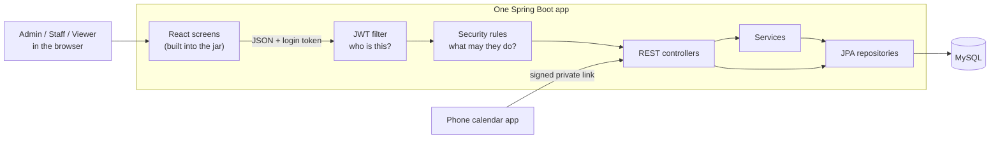
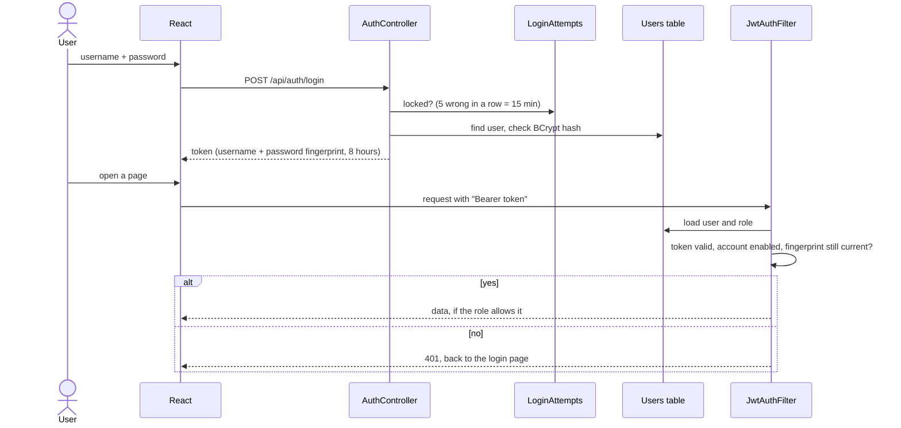
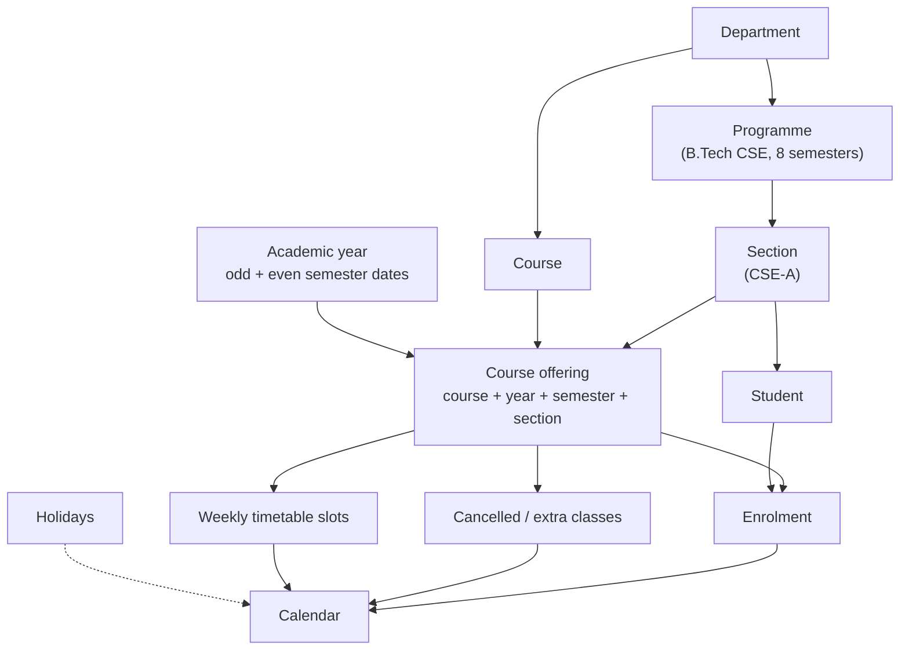
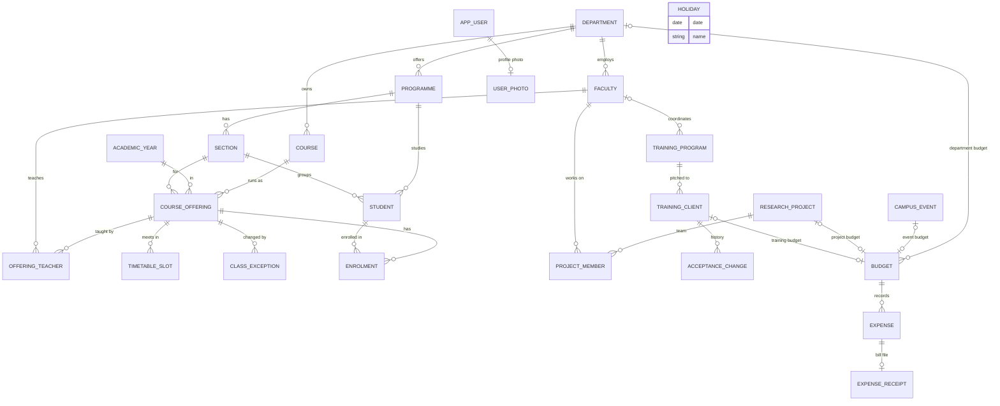

# Campus ERP

[](https://github.com/Git-punit/campus-erp/actions/workflows/ci.yml)

A web app for running a college campus: faculty, students, courses and
timetables, research projects, training programs, events, and every rupee
spent through budgets with admin approval. A dashboard on top shows what's
happening without opening every page.

**Backend:** Spring Boot 4.1 on Java 25 (JPA, Spring Security + JWT, MySQL)<br>
**Frontend:** React 19 + TypeScript with Vite, in [`frontend/`](frontend)

## Contents

- [What it does](#what-it-does)
- [Quick start](#quick-start)
- [Who can do what](#who-can-do-what)
- [Features in detail](#features-in-detail)
- [Configuration](#configuration)
- [Deploying](#deploying)
- [Tests](#tests)
- [Architecture](#architecture)
- [Troubleshooting](#troubleshooting)

## What it does

| Module | What you can do |
|---|---|
| **Dashboard** | See staff and student counts, courses running this semester, today's classes, project funds used, the training pipeline, budget usage, expenses waiting for approval and upcoming events |
| **Faculty** | Keep staff records; see which courses each teacher takes and which projects they're on |
| **Courses** | Keep the course catalogue; plan offerings (which course runs for which section, who teaches it, when) with clash warnings |
| **Students** | Keep student records, enrol whole sections at once, see each student's class calendar |
| **Calendar** | Day, week and month views for any student or teacher, built from the timetable; cancel or add single classes |
| **Research projects** | Track funded projects, their team and how much of the sanctioned money is spent |
| **Training programs** | Pitch programs to outside clients and follow each one from proposal to delivery, with profit or loss |
| **Events** | Plan campus events with dates, venue, status and an optional budget |
| **Budgets** | Department, event, training and project budgets; staff raise expenses, admins approve them |
| **Academic setup** | Departments, programmes, sections, academic years with semester dates, holidays |
| **Users** | Admin only: create accounts and set roles |
| **My account** | Everyone: edit your details and photo, change username or password, log out other devices |

How it fits together: a **course** is **offered** for a semester and section,
**teachers** are assigned to the offering, **students** enrol in it, and the
**calendar** is worked out from those offerings minus holidays. Projects,
accepted training clients, events and departments each get a **budget**, and
approved **expenses** are charged against it.

## Quick start

You need **Java 25** and **Node 20+**. MySQL is optional for trying it out.

**1. Start the backend** (port 8080). The `dev` profile uses a built-in
database kept in the `data/` folder and fills it with sample data the first
time:

```bash
./mvnw spring-boot:run -Dspring-boot.run.profiles=dev
```

Wait for `Started CampusErpApplication`. http://localhost:8080/api/health
should then show `"status":"ok"`.

**2. Start the frontend** (port 5173, passes `/api` calls on to 8080), in a
second terminal:

```bash
cd frontend && npm install && npm run dev
```

**3. Open http://localhost:5173** and log in:

| Username | Password | Role |
|---|---|---|
| `admin` | `admin123` | everything |
| `staff` | `staff123` | add and edit, raise expenses |
| `viewer` | `viewer123` | read only |

These passwords exist only in the `dev` profile. Delete the `data/` folder to
start again from fresh sample data (described in
[sample-data/README.md](src/main/resources/sample-data/README.md)).

**Using your local MySQL instead?** Keep the `dev` profile and point it at
MySQL (the `campus_erp` database is created on first start):

```bash
export DB_URL='jdbc:mysql://localhost:3306/campus_erp?createDatabaseIfNotExist=true'
export DB_USERNAME=root
export DB_PASSWORD='your-mysql-password'
```

```bash
./mvnw spring-boot:run -Dspring-boot.run.profiles=dev
```

## Who can do what

| Role | Can |
|---|---|
| **Admin** | everything, including users and approving or rejecting expenses |
| **Staff** | add, edit and delete in every module; raise expenses |
| **Viewer** | read everything, change nothing |

Faculty and students don't log in; staff open their pages for them.

Every account has **My account** in the sidebar:

- edit your name, designation, email and phone
- upload a profile photo (JPG or PNG, up to 2 MB), shown in the sidebar
- change your username (needs your password; old records keep the old name)
- change your password, which logs you out on every other device
- log out of all other devices without changing your password

Logins last 8 hours. After 5 wrong passwords in a row, that username is locked
for 15 minutes.

## Features in detail

### Faculty

A teacher record has employee ID, name, department, designation, email, phone
and status (Active / On leave / Left). The faculty list shows how many courses
each teacher takes this academic year and how many projects they're on; click
a number to see the list behind it. Older years stay available through a year
filter. An offering with two teachers (say theory and lab) counts for both.

### Courses and timetables

A **course** is a code, name, credits and department. An **offering** is one
run of a course for an academic year, semester and section, with one or more
teachers (Theory / Lab / Tutorial) and weekly timetable slots. The same course
for two branches is two offerings.

Saving a timetable warns when a teacher or room is booked twice, or a section
has two classes at once.

### Students and the calendar

A student record has roll number, name, programme, current semester, section,
email, phone and status. Enrol a whole section into its offerings in one go
(say, all of Sem 3 CSE-A), or one student at a time.

The calendar is never typed in. Weekly classes repeat through the semester,
holidays are skipped, and a single class can be cancelled or an extra one added
for one date.

**Add to phone calendar** on any student's or teacher's calendar gives a
private link for Google Calendar, Outlook or a phone. It updates by itself
when classes change. Anyone with the link can see those classes, so treat it
like a password.

### Research projects

Title, funding agency (DST, SERB, AICTE...), sanctioned amount, dates, status,
and a team of one principal investigator plus co-investigators. Adding a
project creates its budget. Utilized is the total of approved expenses,
balance is sanctioned minus utilized, and the bar turns red past 100%.

### Training programs

A program, with a coordinating teacher, is pitched to many clients. Each client
moves through the steps in order: proposal submitted, accepted (yes / no /
needs revision), conducted. Every change of answer is kept as history. When a
client accepts, a training budget is created for the amount needed; profit or
loss is the fee minus approved expenses.

### Events

Name, type, start and end dates, venue and status (Planned / Ongoing /
Completed / Cancelled). An event can have its own budget.

### Budgets and expenses

Every rupee spent goes through here, against exactly one budget.

| Budget | Created | Amount |
|---|---|---|
| Department | by hand, one per department per financial year (April to March) | the yearly amount |
| Event | from the event | as entered |
| Training | automatically when a client accepts | the amount needed |
| Research project | automatically when the project is added | the sanctioned amount |

1. Staff raise an expense request, optionally with the bill attached (PDF,
   JPG or PNG, up to 5 MB).
2. An admin approves or rejects it, and is warned first if approving would go
   over the budget.
3. Only approved expenses count as spent. Each budget shows allocated, spent,
   pending and balance, with an overspend flag.

An expense on a department budget must be dated inside that budget's
financial year.

### Import and export

- **Export CSV** on the faculty, students, courses, events, budgets and expense
  lists downloads exactly what's on screen, filters included. Excel opens it.
- **Import CSV** on Students and Faculty adds many records at once, with a
  template to download. Every line is checked first: if any line is wrong,
  nothing is saved and the lines to fix are listed by their Excel line number.

## Configuration

Settings come from environment variables. With the `dev` profile you don't
need to set any.

| Variable | Default | What it's for |
|---|---|---|
| `DB_URL` | `jdbc:mysql://localhost:3306/campus_erp?createDatabaseIfNotExist=true` | database address |
| `DB_USERNAME` / `DB_PASSWORD` | `root` / empty | database login |
| `JWT_SECRET` | none, **required** (dev profile: a dev value) | signs logins and calendar links; 32+ characters |
| `ADMIN_PASSWORD`, `STAFF_PASSWORD`, `VIEWER_PASSWORD` | none (dev profile: dev values) | passwords for the three accounts made on an empty database; needed only that first time |
| `SEED_DEMO_DATA` | `false` (dev profile: `true`) | fill an empty database with the sample data |
| `APP_TIME_ZONE` | `Asia/Kolkata` | the time zone for "today" (dashboard, calendar, financial year), whatever the server's clock says |
| `SERVER_PORT` | `8080` | web port |

Business rules such as the financial year starting in April are under `app.*`
in [application.properties](src/main/resources/application.properties).

## Deploying

The app ships as **one program**: the React screens are built into the Spring
Boot jar, so a server needs only that and a MySQL database. Uploaded receipts
and photos are stored in the database, so no extra disk is needed.

### Build and run the jar yourself

```bash
cd frontend && npm run build && cd .. && ./mvnw package
```

Set `JWT_SECRET`, the `DB_*` variables and, for the first start, the three
passwords. Then run:

```bash
java -jar target/campus-erp-0.0.1-SNAPSHOT.jar
```

Without `JWT_SECRET` it stops at once with `Could not resolve placeholder
'JWT_SECRET'`. That's on purpose: there are no public defaults outside the
`dev` profile.

### On Railway (or any host that builds a Dockerfile)

The `Dockerfile` in the project root builds the screens and the jar together.
On [Railway](https://railway.com):

1. **New Project → Deploy from GitHub repo**, and pick this repository.
2. **New → Database → MySQL** in the same project.
3. In the app's **Variables**, add:

   ```
   DB_URL=jdbc:mysql://${{MySQL.MYSQLHOST}}:${{MySQL.MYSQLPORT}}/${{MySQL.MYSQLDATABASE}}
   DB_USERNAME=${{MySQL.MYSQLUSER}}
   DB_PASSWORD=${{MySQL.MYSQLPASSWORD}}
   JWT_SECRET=<output of: openssl rand -base64 48>
   ADMIN_PASSWORD=<choose one>
   STAFF_PASSWORD=<choose one>
   VIEWER_PASSWORD=<choose one>
   ```

4. **Settings → Networking → Generate Domain.**
5. Open `https://<your-domain>/api/health`, then log in as `admin` and change
   the three passwords under My account.

The database starts empty. Add `SEED_DEMO_DATA=true` before the first deploy
to try it with sample data. Every push to `main` deploys again.

## Tests

```bash
./mvnw test
```

Tests use an in-memory database, so no MySQL is needed. "Today" is pinned to
18 Nov 2026 in India time, so results are the same on any machine.
[GitHub Actions](.github/workflows/ci.yml) runs them, plus the frontend build,
on every push to `main` and every pull request.

## Architecture

The diagrams are written in Mermaid, which GitHub draws as pictures.

### The whole system



### Logging in

The password is checked against its BCrypt hash. The token the browser gets
back carries a signed fingerprint of the password, so changing the password
(or "log out of all other devices") ends every older token. On each request
the user is loaded again, so a role change or a disabled account takes effect
at once.



### Academic structure



### Database tables

Every table also has `id`, `created_at` and `updated_at`. Login accounts
(`APP_USER`) are separate from faculty and students. Files sit in their own
tables, so lists never load them.



### Where the code is

| Folder | What's in it |
|---|---|
| `src/main/java/com/campuserp/` | one package per module: `faculty`, `course`, `student`, `calendar`, `project`, `training`, `event`, `budget`, `setup`, `dashboard`, `user` |
| `.../auth` | login, tokens, the login lock |
| `.../config` | security rules, the campus clock, serving the React app |
| `.../common` | shared pieces: error replies, CSV reading and importing, money helpers |
| `.../seed` | the three starting accounts and the sample data loader |
| `src/main/resources/` | settings, and `sample-data/` (21 CSV files) |
| `src/test/` | API tests for every module |
| `frontend/src/pages/` | one file per screen |
| `frontend/src/components/` | shared pieces: list-and-form section, calendar, expense table, import box, photo |
| `frontend/src/api.ts`, `auth.tsx` | calls to the backend, and who is logged in |

Bigger modules (courses, budgets, training, users) have a service class;
simpler ones call their repositories straight from the controller.

## Troubleshooting

**"Can't reach the server" on the login page.** The backend isn't running, or
stopped with an error. Start it with the `dev` profile (see
[Quick start](#quick-start)) and look at its last lines.

**`Could not resolve placeholder 'JWT_SECRET'`.** It was started without the
`dev` profile. Add `-Dspring-boot.run.profiles=dev`, or set `JWT_SECRET`.

**`Access denied for user 'root'`.** The MySQL password in `DB_PASSWORD` is
wrong, or not set.

**Startup fails mentioning a file like `BudgetDtos 2.class`.** The project is
in a folder synced by iCloud (such as the Desktop), which copies build files.
Run `./mvnw clean`, or move the project to a folder iCloud doesn't sync.

**`Port 8080 was already in use`.** Another copy is still running. Stop it, or
start this one with `SERVER_PORT=8081` (then change the port in
`frontend/vite.config.ts` too).
