# campus-erp

ERP for running a college campus. It keeps track of faculty, students,
courses, research projects, training programs, events and budgets, and has a
dashboard on top so you can see what's going on without opening every page.

Backend is Spring Boot 4.1 on Java 25 (JPA, Spring Security + JWT, MySQL).
Frontend is React 19 + TypeScript with Vite, in the `frontend` folder.

Fee management, attendance and library were in an older version and have been
dropped for now.

## 1. Overall system architecture

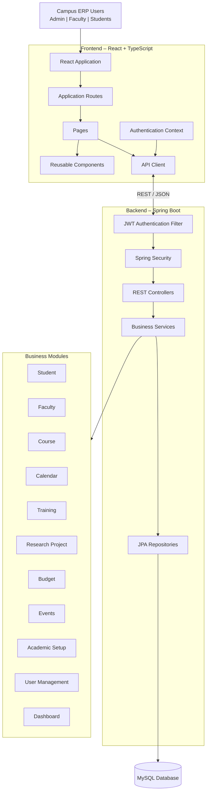

## 2. Complete project directory structure

Generated frontend bundles, `node_modules`, and Maven build output are omitted
from this source tree because they are generated locally and are ignored by
Git.

```text
campus-erp/
├── .mvn/
│   └── wrapper/
│       └── maven-wrapper.properties
├── .vscode/
│   └── tasks.json
├── frontend/
│   ├── index.html
│   ├── package.json
│   ├── package-lock.json
│   ├── tsconfig.json
│   ├── vite.config.ts
│   └── src/
│       ├── App.tsx
│       ├── api.ts
│       ├── auth.tsx
│       ├── main.tsx
│       ├── styles.css
│       ├── components/
│       │   ├── CalendarView.tsx
│       │   ├── CrudSection.tsx
│       │   ├── ExpenseTable.tsx
│       │   └── ui.tsx
│       ├── layout/
│       │   └── Layout.tsx
│       ├── lib/
│       │   ├── format.ts
│       │   ├── types.ts
│       │   └── useLoad.ts
│       └── pages/
│           ├── BudgetDetailPage.tsx
│           ├── BudgetsPage.tsx
│           ├── CalendarPage.tsx
│           ├── CoursesPage.tsx
│           ├── DashboardPage.tsx
│           ├── EventsPage.tsx
│           ├── FacultyDetailPage.tsx
│           ├── FacultyPage.tsx
│           ├── LoginPage.tsx
│           ├── PlaceholderPage.tsx
│           ├── ProjectsPage.tsx
│           ├── SetupPage.tsx
│           ├── StudentDetailPage.tsx
│           ├── StudentsPage.tsx
│           ├── TrainingPage.tsx
│           ├── TrainingProgramPage.tsx
│           └── UsersPage.tsx
├── src/
│   ├── main/
│   │   ├── java/com/campuserp/
│   │   │   ├── CampusErpApplication.java
│   │   │   ├── auth/
│   │   │   │   ├── AuthController.java
│   │   │   │   ├── JwtAuthFilter.java
│   │   │   │   └── JwtService.java
│   │   │   ├── budget/
│   │   │   │   ├── Budget.java
│   │   │   │   ├── BudgetController.java
│   │   │   │   ├── BudgetDtos.java
│   │   │   │   ├── BudgetRepository.java
│   │   │   │   ├── BudgetService.java
│   │   │   │   ├── BudgetType.java
│   │   │   │   ├── Expense.java
│   │   │   │   ├── ExpenseCategory.java
│   │   │   │   ├── ExpenseRepository.java
│   │   │   │   ├── ExpenseService.java
│   │   │   │   └── ExpenseStatus.java
│   │   │   ├── calendar/
│   │   │   │   ├── CalendarController.java
│   │   │   │   ├── CalendarEntry.java
│   │   │   │   └── CalendarService.java
│   │   │   ├── common/
│   │   │   │   ├── ApiError.java
│   │   │   │   ├── BaseEntity.java
│   │   │   │   ├── BusinessRuleException.java
│   │   │   │   ├── Finder.java
│   │   │   │   ├── GlobalExceptionHandler.java
│   │   │   │   ├── HealthController.java
│   │   │   │   ├── Money.java
│   │   │   │   ├── NotFoundException.java
│   │   │   │   └── Ref.java
│   │   │   ├── config/
│   │   │   │   ├── ClockConfig.java
│   │   │   │   └── SecurityConfig.java
│   │   │   ├── course/
│   │   │   │   ├── ClassException.java
│   │   │   │   ├── ClassExceptionRepository.java
│   │   │   │   ├── Course.java
│   │   │   │   ├── CourseController.java
│   │   │   │   ├── CourseOffering.java
│   │   │   │   ├── CourseOfferingRepository.java
│   │   │   │   ├── CourseRepository.java
│   │   │   │   ├── ExceptionType.java
│   │   │   │   ├── OfferingController.java
│   │   │   │   ├── OfferingDtos.java
│   │   │   │   ├── OfferingService.java
│   │   │   │   ├── OfferingTeacher.java
│   │   │   │   ├── OfferingTeacherRepository.java
│   │   │   │   ├── TeachingRole.java
│   │   │   │   └── TimetableSlot.java
│   │   │   ├── dashboard/
│   │   │   │   └── DashboardController.java
│   │   │   ├── event/
│   │   │   │   ├── Event.java
│   │   │   │   ├── EventController.java
│   │   │   │   ├── EventRepository.java
│   │   │   │   └── EventStatus.java
│   │   │   ├── faculty/
│   │   │   │   ├── Faculty.java
│   │   │   │   ├── FacultyController.java
│   │   │   │   ├── FacultyRepository.java
│   │   │   │   └── FacultyStatus.java
│   │   │   ├── project/
│   │   │   │   ├── MemberRole.java
│   │   │   │   ├── ProjectController.java
│   │   │   │   ├── ProjectMember.java
│   │   │   │   ├── ProjectMemberRepository.java
│   │   │   │   ├── ProjectStatus.java
│   │   │   │   ├── ResearchProject.java
│   │   │   │   └── ResearchProjectRepository.java
│   │   │   ├── seed/
│   │   │   │   ├── Csv.java
│   │   │   │   ├── DemoAccountsSeeder.java
│   │   │   │   └── DemoDataSeeder.java
│   │   │   ├── setup/
│   │   │   │   ├── AcademicCalendar.java
│   │   │   │   ├── AcademicYear.java
│   │   │   │   ├── AcademicYearRepository.java
│   │   │   │   ├── Department.java
│   │   │   │   ├── DepartmentRepository.java
│   │   │   │   ├── Holiday.java
│   │   │   │   ├── HolidayRepository.java
│   │   │   │   ├── Programme.java
│   │   │   │   ├── ProgrammeRepository.java
│   │   │   │   ├── Section.java
│   │   │   │   ├── SectionRepository.java
│   │   │   │   └── SetupController.java
│   │   │   ├── student/
│   │   │   │   ├── Enrolment.java
│   │   │   │   ├── EnrolmentRepository.java
│   │   │   │   ├── Student.java
│   │   │   │   ├── StudentController.java
│   │   │   │   ├── StudentRepository.java
│   │   │   │   └── StudentStatus.java
│   │   │   ├── training/
│   │   │   │   ├── Acceptance.java
│   │   │   │   ├── AcceptanceChange.java
│   │   │   │   ├── AcceptanceChangeRepository.java
│   │   │   │   ├── TrainingClient.java
│   │   │   │   ├── TrainingClientRepository.java
│   │   │   │   ├── TrainingController.java
│   │   │   │   ├── TrainingDtos.java
│   │   │   │   ├── TrainingProgram.java
│   │   │   │   ├── TrainingProgramRepository.java
│   │   │   │   └── TrainingService.java
│   │   │   └── user/
│   │   │       ├── Role.java
│   │   │       ├── User.java
│   │   │       ├── UserController.java
│   │   │       ├── UserRepository.java
│   │   │       ├── UserRequests.java
│   │   │       ├── UserResponse.java
│   │   │       └── UserService.java
│   │   └── resources/
│   │       ├── application.properties
│   │       └── sample-data/
│   │           ├── academic_years.csv
│   │           ├── class_exceptions.csv
│   │           ├── course_offerings.csv
│   │           ├── courses.csv
│   │           ├── department_budgets.csv
│   │           ├── departments.csv
│   │           ├── enrolments.csv
│   │           ├── events.csv
│   │           ├── faculty.csv
│   │           ├── holidays.csv
│   │           ├── offering_teachers.csv
│   │           ├── programmes.csv
│   │           ├── project_team.csv
│   │           ├── research_projects.csv
│   │           ├── sections.csv
│   │           ├── students.csv
│   │           ├── training_acceptance_history.csv
│   │           ├── training_clients.csv
│   │           ├── training_programs.csv
│   │           ├── timetable_slots.csv
│   │           └── README.md
│   └── test/
│       ├── java/com/campuserp/
│       │   ├── ApiTest.java
│       │   ├── CampusErpApplicationTests.java
│       │   ├── Fixtures.java
│       │   ├── TestClock.java
│       │   ├── TestLogins.java
│       │   ├── budget/BudgetAndExpenseTest.java
│       │   ├── calendar/CalendarTest.java
│       │   ├── common/HealthAndErrorsTest.java
│       │   ├── course/OfferingsTest.java
│       │   ├── seed/SampleDataTest.java
│       │   ├── student/EnrolmentTest.java
│       │   ├── training/TrainingTest.java
│       │   └── user/AuthAndRolesTest.java
│       └── resources/application.properties
├── .gitattributes
├── .gitignore
├── HELP.md
├── README.md
├── mvnw
├── mvnw.cmd
├── package-lock.json
└── pom.xml
```

## 3. Frontend architecture

The frontend follows a component-based React architecture.

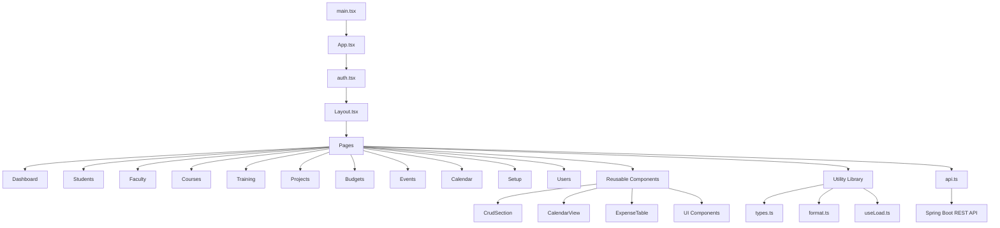

## 4. Frontend component and page structure

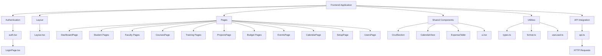

## 5. Backend architecture

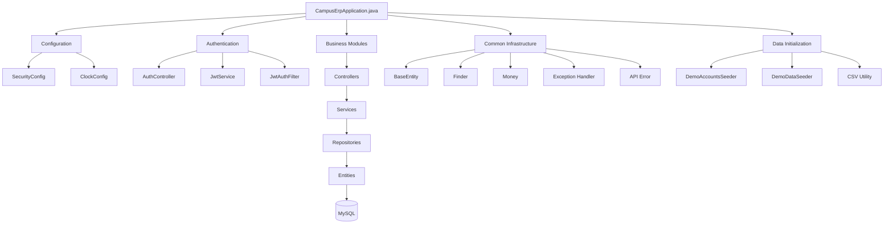

## 6. Backend package/module structure

```mermaid
flowchart TD
    ROOT["com.campuserp"]

    ROOT --> AUTH["auth"]
    ROOT --> CONFIG["config"]
    ROOT --> COMMON["common"]
    ROOT --> USER["user"]
    ROOT --> STUDENT["student"]
    ROOT --> FACULTY["faculty"]
    ROOT --> COURSE["course"]
    ROOT --> CALENDAR["calendar"]
    ROOT --> TRAINING["training"]
    ROOT --> PROJECT["project"]
    ROOT --> BUDGET["budget"]
    ROOT --> EVENT["event"]
    ROOT --> SETUP["setup"]
    ROOT --> DASH["dashboard"]
    ROOT --> SEED["seed"]

    AUTH --> A1["AuthController"]
    AUTH --> A2["JwtService"]
    AUTH --> A3["JwtAuthFilter"]

    CONFIG --> C1["SecurityConfig"]
    CONFIG --> C2["ClockConfig"]

    COMMON --> CM1["BaseEntity"]
    COMMON --> CM2["GlobalExceptionHandler"]
    COMMON --> CM3["Finder / Ref / Money"]

    USER --> U1["UserController"]
    USER --> U2["UserService"]
    USER --> U3["UserRepository"]
    USER --> U4["User / Role"]

    STUDENT --> S1["StudentController"]
    STUDENT --> S2["StudentRepository"]
    STUDENT --> S3["EnrolmentRepository"]
    STUDENT --> S4["Student / Enrolment"]

    COURSE --> CR1["CourseController"]
    COURSE --> CR2["OfferingController"]
    COURSE --> CR3["OfferingService"]
    COURSE --> CR4["Course Repositories"]

    CALENDAR --> CA1["CalendarController"]
    CALENDAR --> CA2["CalendarService"]
    CALENDAR --> CA3["CalendarEntry"]

    TRAINING --> T1["TrainingController"]
    TRAINING --> T2["TrainingService"]
    TRAINING --> T3["Training Repositories"]

    PROJECT --> P1["ProjectController"]
    PROJECT --> P2["ResearchProjectRepository"]
    PROJECT --> P3["ProjectMemberRepository"]

    BUDGET --> BU1["BudgetController"]
    BUDGET --> BU2["BudgetService"]
    BUDGET --> BU3["ExpenseService"]
    BUDGET --> BU4["Repositories"]

    EVENT --> EV1["EventController"]
    EVENT --> EV2["EventRepository"]

    SETUP --> SE1["SetupController"]
    SETUP --> SE2["Academic Setup Repositories"]

    DASH --> D1["DashboardController"]

    SEED --> SD1["DemoDataSeeder"]
    SEED --> SD2["DemoAccountsSeeder"]
```

## 7. Authentication and authorization flow

This diagram explains the JWT-based security architecture.

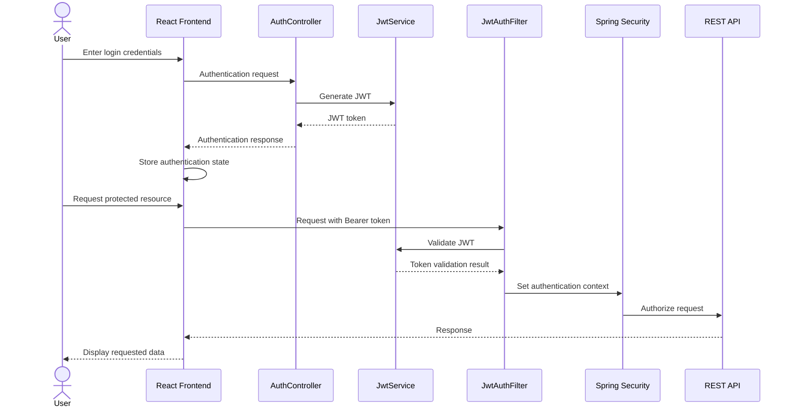

## 8. REST API request lifecycle

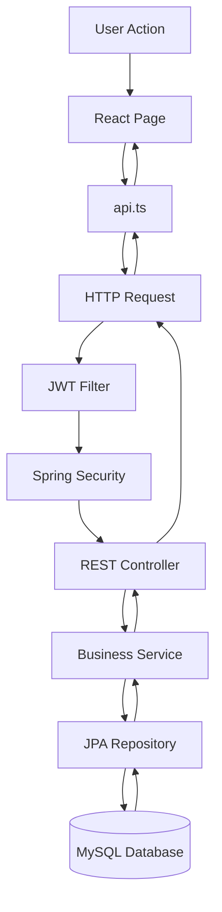

## 9. Academic management module

This diagram shows how the main academic areas fit together.

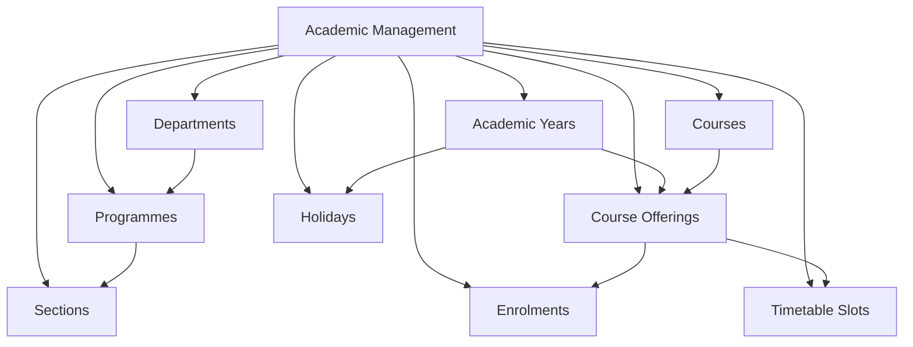

## 10. Student and enrolment module

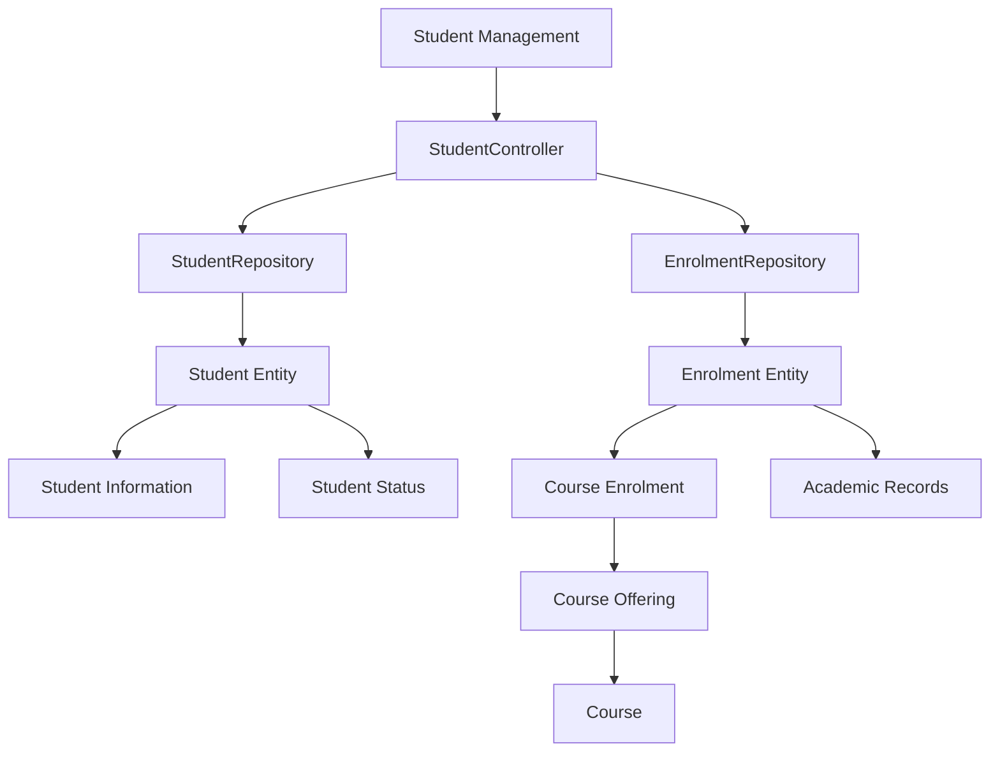

## 11. Course and timetable module

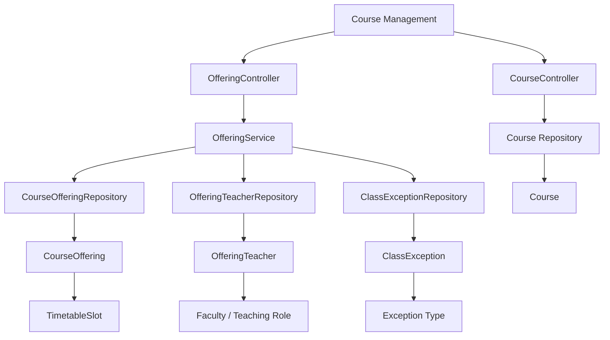

## 12. Faculty management module

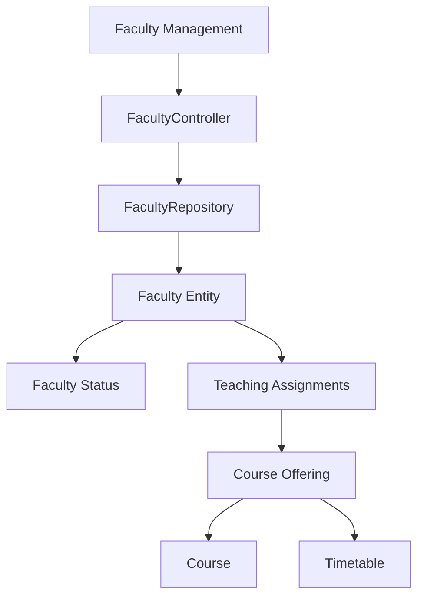

## 13. Training management module

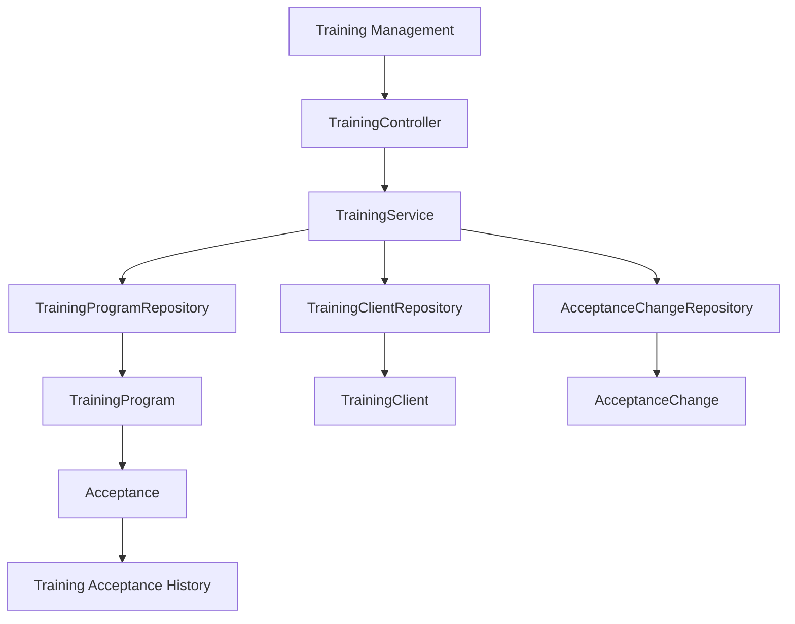

## 14. Research project management module

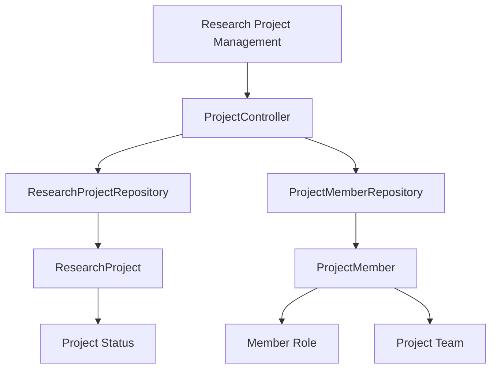

## 15. Budget and expense management module

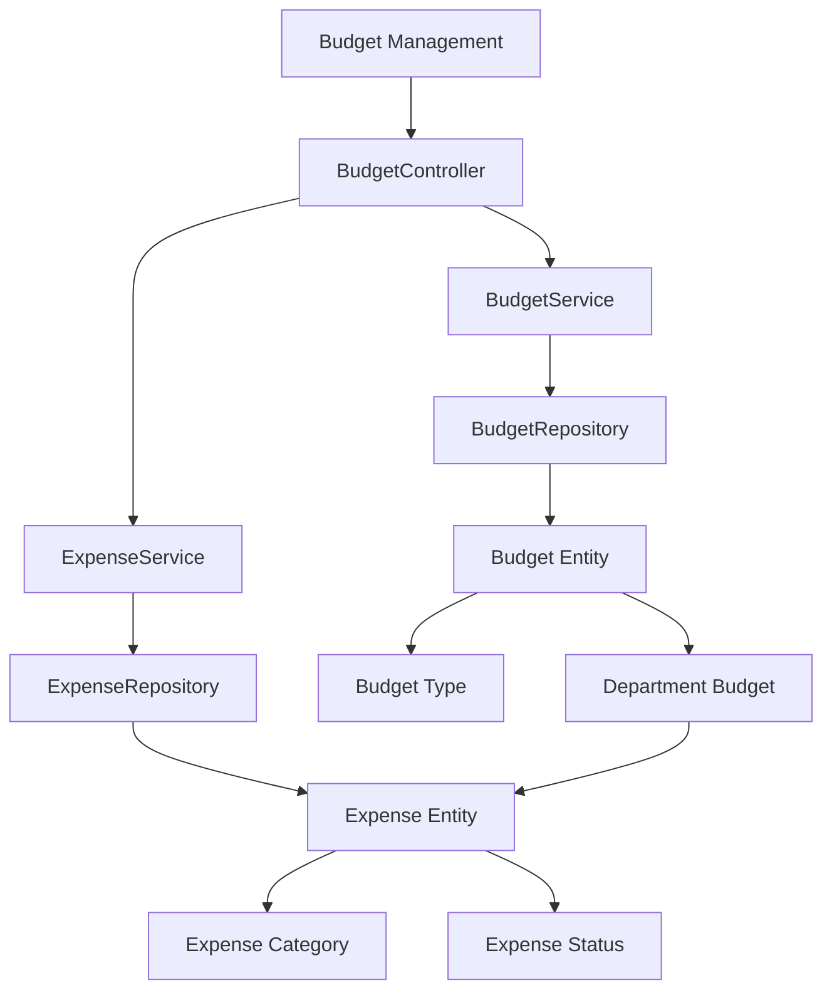

## 16. Events and calendar module

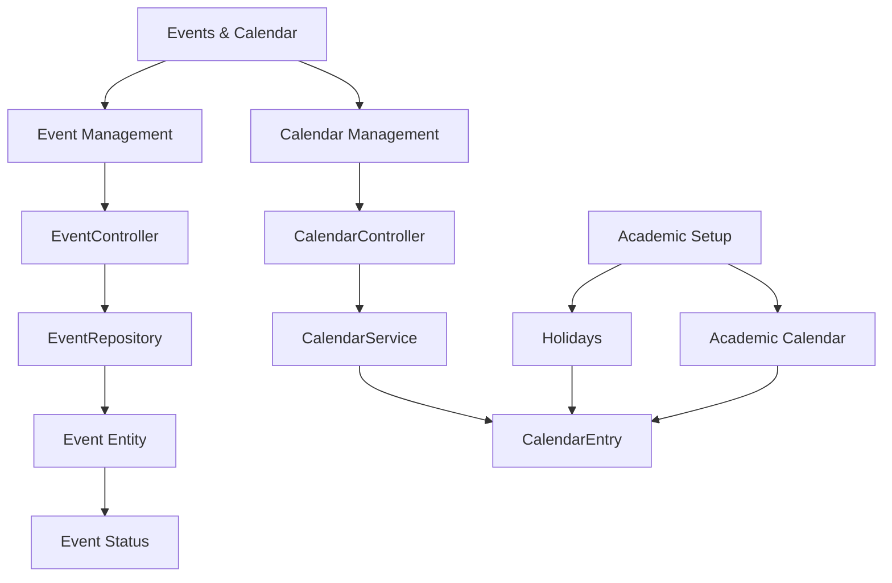

## 17. Dashboard and reporting module

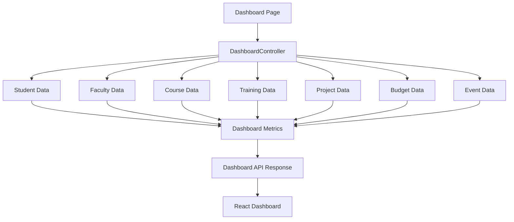

## 18. Academic setup module

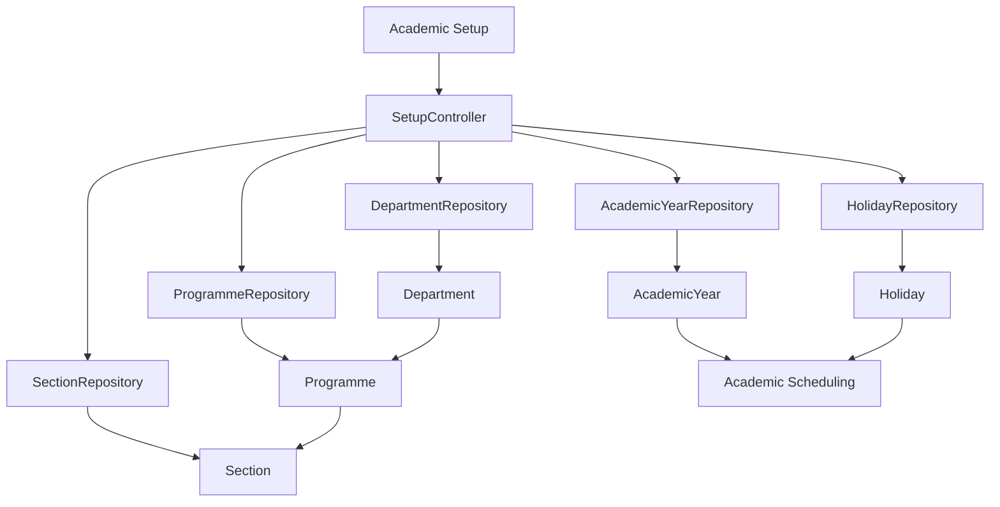

## 19. Database entity relationship overview

The following is a conceptual domain relationship diagram based on the entity
classes in this project. It is not a substitute for the exact MySQL
foreign-key schema.

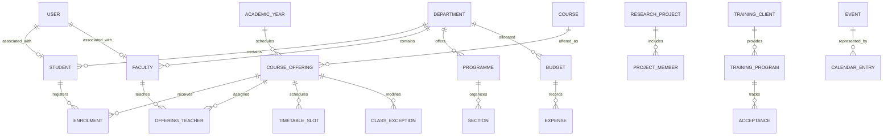

## 20. Application startup and sample data initialization

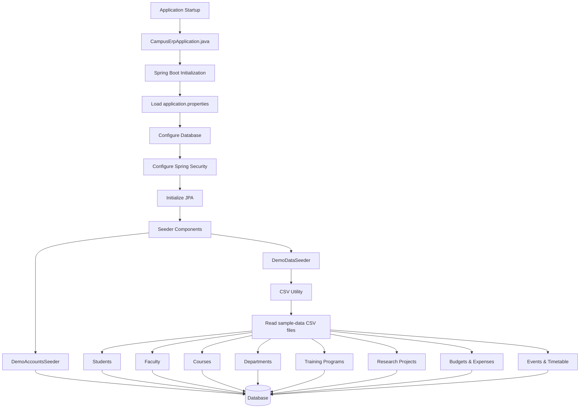

## Modules

- **Dashboard** - faculty and student counts, courses running this semester,
  today's classes, project funds used, training pipeline, budget usage,
  expenses waiting for approval, upcoming events
- **Faculty** - staff records, which courses each teacher teaches per
  semester, and which research projects they're on
- **Courses** - the course catalogue, plus offerings (which course runs in
  which semester/section, who teaches it, and when)
- **Students** - profile, programme, semester, section, enrolments and a class
  calendar
- **Research projects** - funded projects, team, sanctioned amount and spend
- **Training programs** - programs we pitch to outside clients, from first
  contact to delivery, with fee vs cost
- **Events** - campus events with dates, venue and status
- **Budgets** - department / event / training / project budgets, expense
  requests and admin approval
- **Academic setup** - departments, programmes, sections, academic years,
  semester dates, holidays
- **Users** - admin only

Roughly: a course gets offered in a semester for a section, teachers are
assigned to the offering, students enrol in it, and the calendar is built
from those offerings minus holidays. Projects, accepted training proposals,
events and departments each get a budget, and approved expenses are charged
against those budgets.

## Faculty

Faculty record: employee ID, name, department, designation, email, phone and
status (Active / On leave / Left).

The faculty list has a Courses count and a Projects count for each teacher.
Click either one to see the actual list. For example, a maths teacher's
courses might look like:

| Course | Semester | Section | Year |
|---|---|---|---|
| Maths I | 1 | CSE-A | 2026-27 |
| Maths II | 2 | CSE-A | 2026-27 |
| Maths I | 3 | Civil-A | 2026-27 |
| Maths I | 4 | Mech-A | 2026-27 |

A few things to know:

- The same course running for two branches is two separate offerings.
- An offering can have more than one teacher (e.g. theory + lab), and it
  shows up for each of them.
- Old academic years aren't deleted. The list defaults to the current year
  and you can filter back.

The projects list shows funding agency, amount, utilized and balance for each
project (see Research projects below for how those are calculated).

## Courses

A course is just code, name, credits and department.

An offering is one run of a course:

- course, academic year, semester (1-8), programme, section
- one or more teachers, optionally tagged Theory / Lab / Tutorial
- weekly timetable slots (day, start, end, room)

When you save a timetable it warns you if a teacher or room is double booked,
or if a section has two classes at the same time.

## Students

Student record: roll number, name, programme, current semester, section,
email, phone, status.

Enrolment can be done for a whole section at once (e.g. put all of Sem 3
CSE-A into its offerings) or one student at a time.

### Calendar

Nobody types in the calendar. It's generated from the student's enrolments
and the timetables of those offerings:

- weekly classes repeat from semester start to semester end
- holidays from Academic setup are skipped
- a single class can be cancelled for one date, with a reason
- extra one-off classes can be added for a date/time/room
- day, week and month views

Teachers get the same calendar for the classes they teach.

## Research projects

Each project has a title, funding agency (DST, SERB, AICTE etc.), sanctioned
amount, sanction/start/end dates, status (Ongoing / Completed / Closed) and a
team: one PI plus any co-investigators. The project shows up under every team
member.

We assume the full sanctioned amount comes in at once.

- Utilized = sum of approved expenses
- Balance = sanctioned - utilized
- the progress bar goes red past 100%

Expenses go through the normal approval flow in Budgets. Pending ones are
shown but not counted.

## Training programs

A program has a name, description, duration and a coordinator (one of the
teachers). The same program can be pitched to lots of clients, and each
client gets its own record:

- client name, contact person, phone, email
- date contacted
- proposal submitted (yes/no + date)
- accepted (yes / no / needs revision, with date and remarks)
- conducted (yes/no + dates)
- budget required
- fee charged

The steps have to happen in order: you can't mark it accepted before the
proposal is submitted, or conducted before it's accepted. "Needs revision"
means the proposal went back for changes. Every change to the accepted field
is kept as history.

Once a client accepts, a training budget is created automatically for the
budget required amount. Actual cost is whatever's been approved against that
budget, and profit/loss is fee charged minus actual cost.

The program list shows how many clients were contacted, how many proposals
went out, how many were accepted and how many were conducted.

## Events

Name, type, start/end dates, venue and status (Planned / Ongoing / Completed /
Cancelled). An event can have its own budget.

## Budgets

Any money spent goes through here, against exactly one budget.

| Type | Created | Allocation |
|---|---|---|
| Department | manually, one per department per financial year (Apr-Mar) | yearly amount |
| Event | from the event | whatever's entered |
| Training | automatically when a client accepts | budget required |
| Research project | automatically when the project is added | sanctioned amount |

Expense flow:

1. Staff raise a request: budget, date, amount, category (Equipment / Travel /
   Consumables / Honorarium / Other), description.
2. It sits as Pending until an admin approves or rejects it with a remark.
3. Only approved expenses count as utilized.
4. If approving would push the budget over its allocation, the admin gets a
   warning first.

Each budget shows allocated, utilized, pending and balance, with a usage bar
and an overspend flag. You can filter by type, department and financial year.

## Academic setup

Departments, programmes (like B.Tech CSE, with number of semesters), sections
(CSE-A etc.), academic years with odd/even semester dates, and holidays.

## Roles

| Role | Access |
|---|---|
| ADMIN | everything, including users and expense approval |
| STAFF | create/edit/delete in all modules, raise expenses |
| VIEWER | read only |

Faculty and students don't have logins. Admin/staff open their pages instead.

## Running it locally

Needs Java 25+, Node 20+ and MySQL 8.

Set your MySQL login (the `campus_erp` database gets created on first run):

```bash
export DB_USERNAME=root
export DB_PASSWORD='your-mysql-password'
```

Backend, on port 8080:

```bash
./mvnw spring-boot:run
```

Frontend dev server, on port 5173 (proxies `/api` to 8080):

```bash
cd frontend && npm install && npm run dev
```

Then go to http://localhost:5173.

### Demo data

If the database is empty on startup it creates three users (`admin`, `staff`,
`viewer`) and fills everything with made-up sample data. The passwords are
the `app.seed.*-password` entries in `src/main/resources/application.properties`,
or you can set `ADMIN_PASSWORD`, `STAFF_PASSWORD` and `VIEWER_PASSWORD`.
`SEED_DEMO_DATA=false` turns the sample data off.

The sample records are CSV files in `src/main/resources/sample-data/`. Its
README lists what's in each file and the cases built in on purpose (an
overspent project, a training run at a loss, Diwali inside the semester...).

Don't deploy this with the default passwords or JWT secret. Change the
passwords from the Users page and set `JWT_SECRET` (at least 32 chars).

### One jar

`npm run build` puts the React build into `src/main/resources/static/`, so
Spring Boot serves both the UI and the API:

```bash
cd frontend && npm run build && cd .. && ./mvnw package
```

```bash
java -jar target/campus-erp-0.0.1-SNAPSHOT.jar
```

## Tests

```bash
./mvnw test
```

Tests use in-memory H2, so you don't need MySQL for them. They cover login
and roles (including not being able to remove the last admin), validation,
offerings with multiple teachers and clash warnings, enrolment, the calendar
(weekly classes, holidays, cancelled/extra classes), training step order and
budget creation, expense approval/rejection and the utilized/balance numbers,
and the dashboard. One test loads the full sample data and checks the
numbers quoted in this README, and that the sample timetable has no clashes.

## Config

| Variable | Default | What it's for |
|---|---|---|
| `DB_URL` | `jdbc:mysql://localhost:3306/campus_erp?createDatabaseIfNotExist=true` | JDBC URL |
| `DB_USERNAME` / `DB_PASSWORD` | `root` / empty | MySQL login |
| `JWT_SECRET` | dev value | signs login tokens, change it outside dev |
| `SEED_DEMO_DATA` | `true` | load sample data into an empty db |
| `SERVER_PORT` | `8080` | HTTP port |

Other business settings (like the financial year starting in April) are under
`app.*` in `application.properties`.
