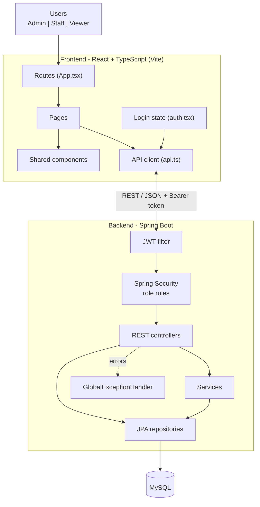
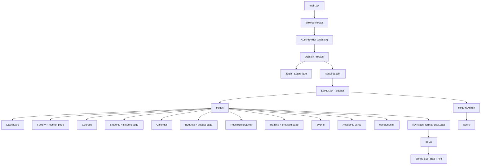
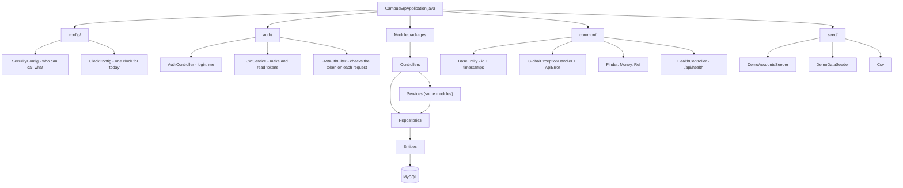
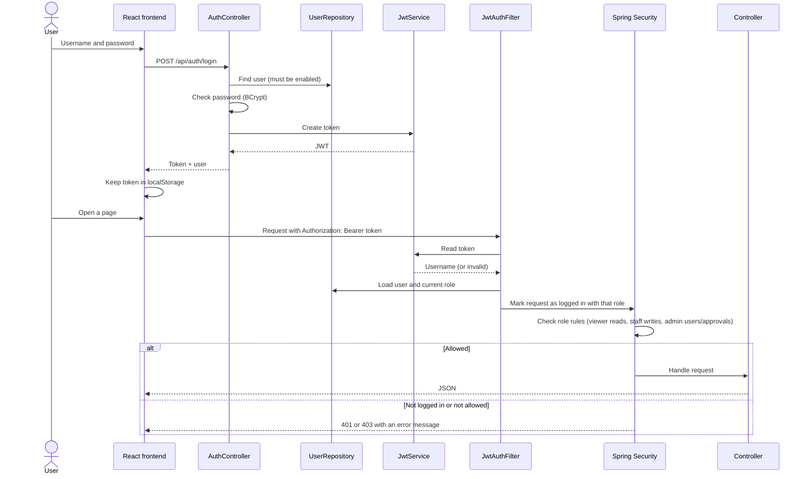
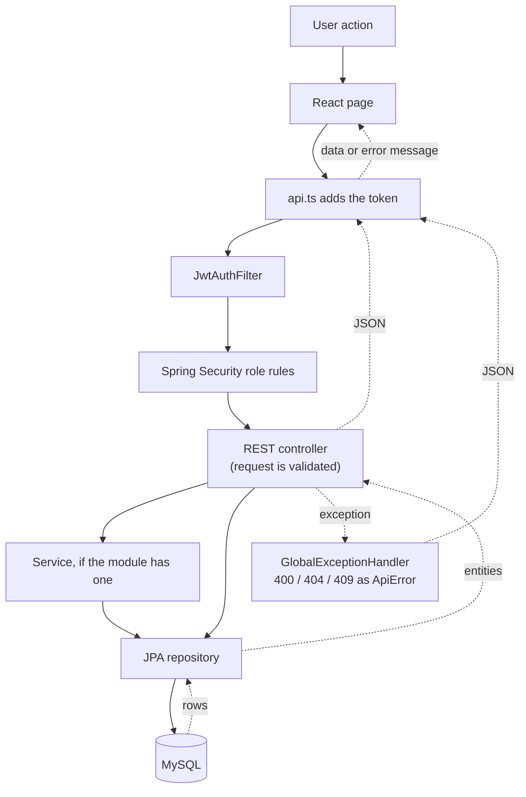
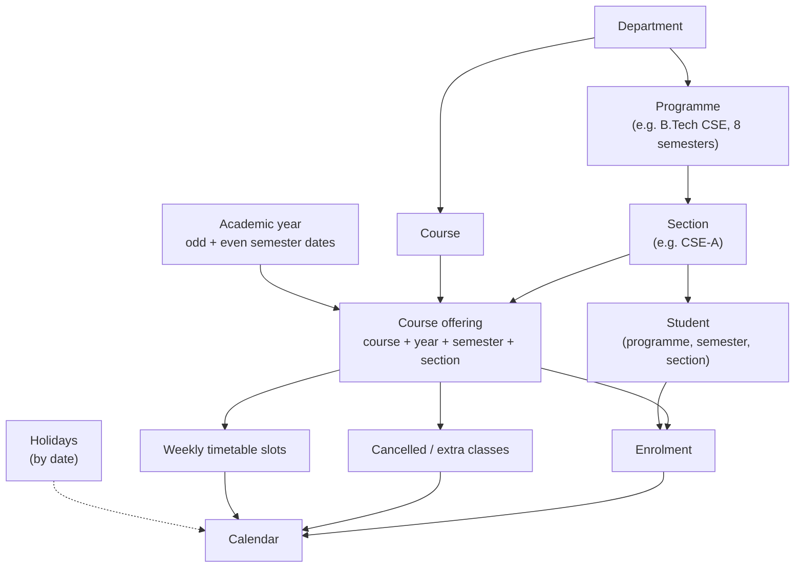
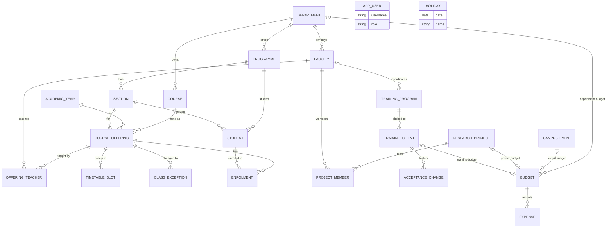

# campus-erp

ERP for running a college campus. It keeps track of faculty, students,
courses, research projects, training programs, events and budgets, and has a
dashboard on top so you can see what's going on without opening every page.

Backend is Spring Boot 4.1 on Java 25 (JPA, Spring Security + JWT, MySQL).
Frontend is React 19 + TypeScript with Vite, in the `frontend` folder.

## Modules

- **Dashboard** - faculty and student counts, courses running this semester,
  today's classes, project funds used, training pipeline, budget usage,
  expenses waiting for approval, upcoming events
- **Faculty** - staff records, which courses each teacher teaches per
  semester, and which research projects they're on
- **Courses** - the course catalogue, plus offerings (which course runs in
  which semester/section, who teaches it, and when)
- **Students** - profile, programme, semester, section, enrolments and a class
  calendar
- **Research projects** - funded projects, team, sanctioned amount and spend
- **Training programs** - programs we pitch to outside clients, from first
  contact to delivery, with fee vs cost
- **Events** - campus events with dates, venue and status
- **Budgets** - department / event / training / project budgets, expense
  requests and admin approval
- **Academic setup** - departments, programmes, sections, academic years,
  semester dates, holidays
- **Users** - admin only

Roughly: a course gets offered in a semester for a section, teachers are
assigned to the offering, students enrol in it, and the calendar is built
from those offerings minus holidays. Projects, accepted training proposals,
events and departments each get a budget, and approved expenses are charged
against those budgets.

## Faculty

Faculty record: employee ID, name, department, designation, email, phone and
status (Active / On leave / Left).

The faculty list has a Courses count (this academic year) and a Projects
count for each teacher; click either to see the list. Past years stay
available through a year filter. An offering with two teachers (e.g. theory +
lab) shows up for both.

## Courses

A course is just code, name, credits and department.

An offering is one run of a course for an academic year, semester and
section, with one or more teachers (Theory / Lab / Tutorial) and weekly
timetable slots. The same course for two branches is two offerings. Saving a
timetable warns if a teacher or room is double booked, or a section has two
classes at once.

## Students

Student record: roll number, name, programme, current semester, section,
email, phone, status.

Enrolment can be done for a whole section at once (e.g. put all of Sem 3
CSE-A into its offerings) or one student at a time.

### Calendar

Built from enrolments and timetables, never typed in. Weekly classes repeat
through the semester, holidays are skipped, and a single class can be
cancelled or an extra one added for a date. Day, week and month views, for
students and for teachers.

## Research projects

Title, funding agency (DST, SERB, AICTE...), sanctioned amount, dates, status
and a team of one PI plus co-investigators. Creating a project creates its
budget. Utilized is the total of approved expenses, balance is sanctioned
minus utilized, and the bar turns red past 100%.

## Training programs

A program (with a coordinator teacher) is pitched to many clients. Each
client moves through the steps in order: proposal submitted, then accepted
(yes / no / needs revision), then conducted. Every change to "accepted" is
kept as history. When a client accepts, a training budget is created for the
budget required; profit/loss is the fee minus approved expenses.

## Events

Name, type, start/end dates, venue and status (Planned / Ongoing / Completed /
Cancelled). An event can have its own budget.

## Budgets

Any money spent goes through here, against exactly one budget.

| Type | Created | Allocation |
|---|---|---|
| Department | manually, one per department per financial year (Apr-Mar) | yearly amount |
| Event | from the event | whatever's entered |
| Training | automatically when a client accepts | budget required |
| Research project | automatically when the project is added | sanctioned amount |

Staff raise expense requests; an admin approves or rejects each one, and is
warned first if approving would go over the allocation. Only approved
expenses count as utilized. Each budget shows allocated, utilized, pending
and balance, with an overspend flag.

## Academic setup

Departments, programmes (like B.Tech CSE, with number of semesters), sections
(CSE-A etc.), academic years with odd/even semester dates, and holidays.

## Roles

| Role | Access |
|---|---|
| ADMIN | everything, including users and expense approval |
| STAFF | create/edit/delete in all modules, raise expenses |
| VIEWER | read only |

Faculty and students don't have logins. Admin/staff open their pages instead.
Everyone can change their own password under **My account** in the sidebar.

## Extras

- **Export CSV** on the faculty, students, courses, events, budgets and
  expense lists downloads what's on screen (filters included). Excel opens it.
- **Import CSV** on Students and Faculty adds many records at once. There's a
  template to download. Every row is checked first; if any row is wrong,
  nothing is saved and the rows to fix are listed.
- **Add to phone calendar** on a student's or teacher's calendar gives a
  private link for Google Calendar, Outlook or a phone. It stays up to date
  by itself. Anyone with the link can see those classes.
- **Receipts:** attach the bill (PDF, JPG or PNG, up to 5 MB) when raising an
  expense or later, while it's pending. Admins see it before approving.

## Running it locally

Needs Java 25 and Node 20+. MySQL 8 is optional for trying it out.

**Quickest: no MySQL.** The `dev` profile uses a built-in database stored in
`data/` in the project folder (kept between runs; delete the folder to start
over from the sample data). Backend, on port 8080:

```bash
./mvnw spring-boot:run -Dspring-boot.run.profiles=dev
```

**With your local MySQL.** Same `dev` profile, pointed at MySQL (the
`campus_erp` database is created on first run). Use your real MySQL password;
if it's wrong the backend stops straight away with `Access denied`.

```bash
export DB_URL='jdbc:mysql://localhost:3306/campus_erp?createDatabaseIfNotExist=true'
export DB_USERNAME=root
export DB_PASSWORD='your-mysql-password'
```

```bash
./mvnw spring-boot:run -Dspring-boot.run.profiles=dev
```

Wait for `Started CampusErpApplication`; http://localhost:8080/api/health
should then show `"status":"ok"`.

Frontend, on port 5173 (proxies `/api` to 8080):

```bash
cd frontend && npm install && npm run dev
```

Then go to http://localhost:5173.

### Demo data

On an empty database it creates three users (`admin`, `staff`, `viewer`). With
the `dev` profile their passwords are `admin123`, `staff123` and `viewer123`,
and it also loads made-up sample data from `src/main/resources/sample-data/`
(see its README).

Those dev values are public, so they only exist in `application-dev.properties`.
Without the `dev` profile (on a server) there are no defaults: set `JWT_SECRET`,
and for the first start `ADMIN_PASSWORD`, `STAFF_PASSWORD` and
`VIEWER_PASSWORD`, or the app won't start. Sample data is off unless
`SEED_DEMO_DATA=true`.

### One jar

`npm run build` puts the React build into `src/main/resources/static/`, so
Spring Boot serves both the UI and the API:

```bash
cd frontend && npm run build && cd .. && ./mvnw package
```

```bash
java -jar target/campus-erp-0.0.1-SNAPSHOT.jar
```


## Tests

```bash
./mvnw test
```

Tests use an in-memory database, so no MySQL is needed. GitHub Actions runs
them, plus the frontend build, on every push to `main` and every pull request.

## Config

| Variable | Default | What it's for |
|---|---|---|
| `DB_URL` | `jdbc:mysql://localhost:3306/campus_erp?createDatabaseIfNotExist=true` | JDBC URL |
| `DB_USERNAME` / `DB_PASSWORD` | `root` / empty | MySQL login |
| `JWT_SECRET` | none (dev profile: a dev value) | signs login tokens and calendar links; required, 32+ characters |
| `ADMIN_PASSWORD` / `STAFF_PASSWORD` / `VIEWER_PASSWORD` | none (dev profile: dev values) | passwords for the accounts created on an empty database; only needed then |
| `SEED_DEMO_DATA` | `false` (dev profile: `true`) | load sample data into an empty db |
| `APP_TIME_ZONE` | `Asia/Kolkata` | the time zone for "today" (dashboard, calendar, financial year), whatever the server's clock is set to |
| `SERVER_PORT` | `8080` | HTTP port |

Other business settings (like the financial year starting in April) are under
`app.*` in `application.properties`.

## Architecture

Diagrams are in Mermaid, which GitHub draws as pictures.

### 1. Overall system

Faculty and students don't log in. Admin, staff and viewers open their pages.



### 2. Project directory structure

Build output (`frontend/node_modules`, `target/`, `src/main/resources/static/`)
and local editor settings are left out.

```text
campus-erp/
├── .github/workflows/ci.yml
├── .mvn/wrapper/maven-wrapper.properties
├── frontend/
│   ├── index.html
│   ├── package.json
│   ├── package-lock.json
│   ├── tsconfig.json
│   ├── vite.config.ts
│   └── src/
│       ├── main.tsx
│       ├── App.tsx
│       ├── auth.tsx
│       ├── api.ts
│       ├── styles.css
│       ├── components/
│       │   ├── CalendarView.tsx
│       │   ├── CrudSection.tsx
│       │   ├── ExpenseTable.tsx
│       │   └── ui.tsx
│       ├── layout/
│       │   └── Layout.tsx
│       ├── lib/
│       │   ├── format.ts
│       │   ├── types.ts
│       │   └── useLoad.ts
│       └── pages/
│           ├── BudgetDetailPage.tsx
│           ├── BudgetsPage.tsx
│           ├── CalendarPage.tsx
│           ├── CoursesPage.tsx
│           ├── DashboardPage.tsx
│           ├── EventsPage.tsx
│           ├── FacultyDetailPage.tsx
│           ├── FacultyPage.tsx
│           ├── LoginPage.tsx
│           ├── PlaceholderPage.tsx
│           ├── ProjectsPage.tsx
│           ├── SetupPage.tsx
│           ├── StudentDetailPage.tsx
│           ├── StudentsPage.tsx
│           ├── TrainingPage.tsx
│           ├── TrainingProgramPage.tsx
│           └── UsersPage.tsx
├── src/
│   ├── main/
│   │   ├── java/com/campuserp/
│   │   │   ├── CampusErpApplication.java
│   │   │   ├── auth/          AuthController, JwtService, JwtAuthFilter
│   │   │   ├── budget/        Budget, Expense, BudgetService, ExpenseService, BudgetController, ...
│   │   │   ├── calendar/      CalendarService, CalendarController, CalendarFeedController, CalendarEntry
│   │   │   ├── common/        BaseEntity, ApiError, GlobalExceptionHandler, Csv, CsvImporter,
│   │   │   │                  Finder, Money, Ref, ...
│   │   │   ├── config/        SecurityConfig, ClockConfig, SpaForwardController
│   │   │   ├── course/        Course, CourseOffering, OfferingTeacher, TimetableSlot,
│   │   │   │                  ClassException, OfferingService, CourseController, OfferingController, ...
│   │   │   ├── dashboard/     DashboardController
│   │   │   ├── event/         Event, EventController, EventRepository, EventStatus
│   │   │   ├── faculty/       Faculty, FacultyController, FacultyRepository, FacultyStatus
│   │   │   ├── project/       ResearchProject, ProjectMember, ProjectController, ...
│   │   │   ├── seed/          DemoAccountsSeeder, DemoDataSeeder, Csv
│   │   │   ├── setup/         Department, Programme, Section, AcademicYear, Holiday,
│   │   │   │                  AcademicCalendar, SetupController, ...
│   │   │   ├── student/       Student, Enrolment, StudentController, ...
│   │   │   ├── training/      TrainingProgram, TrainingClient, AcceptanceChange, TrainingService, ...
│   │   │   └── user/          User, Role, UserService, UserController, ...
│   │   └── resources/
│   │       ├── application.properties
│   │       ├── application-dev.properties
│   │       └── sample-data/   21 CSV files + README.md
│   └── test/
│       ├── java/com/campuserp/
│       │   ├── ApiTest.java, Fixtures.java, TestClock.java, TestLogins.java
│       │   ├── CampusErpApplicationTests.java
│       │   ├── budget/BudgetAndExpenseTest.java
│       │   ├── calendar/CalendarTest.java
│       │   ├── common/HealthAndErrorsTest.java
│       │   ├── config/SpaForwardTest.java
│       │   ├── course/OfferingsTest.java
│       │   ├── seed/SampleDataTest.java
│       │   ├── student/EnrolmentTest.java
│       │   ├── training/TrainingTest.java
│       │   └── user/AuthAndRolesTest.java
│       └── resources/application.properties
├── .gitattributes
├── .gitignore
├── HELP.md
├── README.md
├── mvnw, mvnw.cmd
└── pom.xml
```

### 3. Frontend startup and routing

`main.tsx` wraps the whole app in the router and the login state. The login
page sits outside the layout; every other page needs a login, and Users also
needs the admin role.



### 4. Backend layers

Bigger modules (courses, budgets, training, users) have a service class.
Simpler ones (setup, faculty, students, events, projects) call their
repositories straight from the controller.



### 5. Login and access checks

The password is checked against the BCrypt hash in the database. After that,
every request carries the token, and the user's role is looked up again each
time, so a role change or disabled account takes effect straight away.



### 6. One request from click to database



### 7. Academic structure



### 8. Database tables and links

Every table also has `id`, `created_at` and `updated_at`. App users are
separate from faculty and students.


