# campus-erp

ERP for running a college campus. It keeps track of faculty, students,
courses, research projects, training programs, events and budgets, and has a
dashboard on top so you can see what's going on without opening every page.

Backend is Spring Boot 4.1 on Java 25 (JPA, Spring Security + JWT, MySQL).
Frontend is React 19 + TypeScript with Vite, in the `frontend` folder.

Fee management, attendance and library were in an older version and have been
dropped for now.

## Modules

- **Dashboard** - faculty and student counts, courses running this semester,
  today's classes, project funds used, training pipeline, budget usage,
  expenses waiting for approval, upcoming events
- **Faculty** - staff records, which courses each teacher teaches per
  semester, and which research projects they're on
- **Courses** - the course catalogue, plus offerings (which course runs in
  which semester/section, who teaches it, and when)
- **Students** - profile, programme, semester, section, enrolments and a class
  calendar
- **Research projects** - funded projects, team, sanctioned amount and spend
- **Training programs** - programs we pitch to outside clients, from first
  contact to delivery, with fee vs cost
- **Events** - campus events with dates, venue and status
- **Budgets** - department / event / training / project budgets, expense
  requests and admin approval
- **Academic setup** - departments, programmes, sections, academic years,
  semester dates, holidays
- **Users** - admin only

Roughly: a course gets offered in a semester for a section, teachers are
assigned to the offering, students enrol in it, and the calendar is built
from those offerings minus holidays. Projects, accepted training proposals,
events and departments each get a budget, and approved expenses are charged
against those budgets.

## Faculty

Faculty record: employee ID, name, department, designation, email, phone and
status (Active / On leave / Left).

The faculty list has a Courses count and a Projects count for each teacher.
Click either one to see the actual list. For example, a maths teacher's
courses might look like:

| Course | Semester | Section | Year |
|---|---|---|---|
| Maths I | 1 | CSE-A | 2026-27 |
| Maths II | 2 | CSE-A | 2026-27 |
| Maths I | 3 | Civil-A | 2026-27 |
| Maths I | 4 | Mech-A | 2026-27 |

A few things to know:

- The same course running for two branches is two separate offerings.
- An offering can have more than one teacher (e.g. theory + lab), and it
  shows up for each of them.
- Old academic years aren't deleted. The list defaults to the current year
  and you can filter back.

The projects list shows funding agency, amount, utilized and balance for each
project (see Research projects below for how those are calculated).

## Courses

A course is just code, name, credits and department.

An offering is one run of a course:

- course, academic year, semester (1-8), programme, section
- one or more teachers, optionally tagged Theory / Lab / Tutorial
- weekly timetable slots (day, start, end, room)

When you save a timetable it warns you if a teacher or room is double booked,
or if a section has two classes at the same time.

## Students

Student record: roll number, name, programme, current semester, section,
email, phone, status.

Enrolment can be done for a whole section at once (e.g. put all of Sem 3
CSE-A into its offerings) or one student at a time.

### Calendar

Nobody types in the calendar. It's generated from the student's enrolments
and the timetables of those offerings:

- weekly classes repeat from semester start to semester end
- holidays from Academic setup are skipped
- a single class can be cancelled for one date, with a reason
- extra one-off classes can be added for a date/time/room
- day, week and month views

Teachers get the same calendar for the classes they teach.

## Research projects

Each project has a title, funding agency (DST, SERB, AICTE etc.), sanctioned
amount, sanction/start/end dates, status (Ongoing / Completed / Closed) and a
team: one PI plus any co-investigators. The project shows up under every team
member.

We assume the full sanctioned amount comes in at once.

- Utilized = sum of approved expenses
- Balance = sanctioned - utilized
- the progress bar goes red past 100%

Expenses go through the normal approval flow in Budgets. Pending ones are
shown but not counted.

## Training programs

A program has a name, description, duration and a coordinator (one of the
teachers). The same program can be pitched to lots of clients, and each
client gets its own record:

- client name, contact person, phone, email
- date contacted
- proposal submitted (yes/no + date)
- accepted (yes / no / needs revision, with date and remarks)
- conducted (yes/no + dates)
- budget required
- fee charged

The steps have to happen in order: you can't mark it accepted before the
proposal is submitted, or conducted before it's accepted. "Needs revision"
means the proposal went back for changes. Every change to the accepted field
is kept as history.

Once a client accepts, a training budget is created automatically for the
budget required amount. Actual cost is whatever's been approved against that
budget, and profit/loss is fee charged minus actual cost.

The program list shows how many clients were contacted, how many proposals
went out, how many were accepted and how many were conducted.

## Events

Name, type, start/end dates, venue and status (Planned / Ongoing / Completed /
Cancelled). An event can have its own budget.

## Budgets

Any money spent goes through here, against exactly one budget.

| Type | Created | Allocation |
|---|---|---|
| Department | manually, one per department per financial year (Apr-Mar) | yearly amount |
| Event | from the event | whatever's entered |
| Training | automatically when a client accepts | budget required |
| Research project | automatically when the project is added | sanctioned amount |

Expense flow:

1. Staff raise a request: budget, date, amount, category (Equipment / Travel /
   Consumables / Honorarium / Other), description.
2. It sits as Pending until an admin approves or rejects it with a remark.
3. Only approved expenses count as utilized.
4. If approving would push the budget over its allocation, the admin gets a
   warning first.

Each budget shows allocated, utilized, pending and balance, with a usage bar
and an overspend flag. You can filter by type, department and financial year.

## Academic setup

Departments, programmes (like B.Tech CSE, with number of semesters), sections
(CSE-A etc.), academic years with odd/even semester dates, and holidays.

## Roles

| Role | Access |
|---|---|
| ADMIN | everything, including users and expense approval |
| STAFF | create/edit/delete in all modules, raise expenses |
| VIEWER | read only |

Faculty and students don't have logins. Admin/staff open their pages instead.

## Running it locally

Needs Java 25 and Node 20+. MySQL 8 is optional for trying it out.

**Quickest: no MySQL.** The `dev` profile uses a built-in database stored in
`data/` in the project folder (kept between runs; delete the folder to start
over from the sample data). Backend, on port 8080:

```bash
./mvnw spring-boot:run -Dspring-boot.run.profiles=dev
```

**With MySQL.** Set your MySQL login (the `campus_erp` database gets created on
first run). Use your real MySQL password; if it's wrong the backend stops
straight away with `Access denied for user 'root'`.

```bash
export DB_PASSWORD='your-mysql-password'
```

```bash
./mvnw spring-boot:run
```

Wait for `Started CampusErpApplication` in the backend terminal. You can check
it's up at http://localhost:8080/api/health.

Frontend dev server, on port 5173 (proxies `/api` to 8080):

```bash
cd frontend && npm install && npm run dev
```

Then go to http://localhost:5173.

### Demo data

If the database is empty on startup it creates three users (`admin`, `staff`,
`viewer`) and fills everything with made-up sample data. The passwords are
the `app.seed.*-password` entries in `src/main/resources/application.properties`,
or you can set `ADMIN_PASSWORD`, `STAFF_PASSWORD` and `VIEWER_PASSWORD`.
`SEED_DEMO_DATA=false` turns the sample data off.

The sample records are CSV files in `src/main/resources/sample-data/`. Its
README lists what's in each file and the cases built in on purpose (an
overspent project, a training run at a loss, Diwali inside the semester...).

The default passwords and JWT secret are public (they're in this repo), so the
app won't use them on a server. If the database isn't on your own machine
(localhost, 127.0.0.1 or the in-memory test database) and `JWT_SECRET` is
still the default, it stops at startup and says what to set. The same goes for
`ADMIN_PASSWORD`, `STAFF_PASSWORD` and `VIEWER_PASSWORD` while the accounts
haven't been created yet. Locally it just logs a warning. For a throwaway
demo you can turn the check off with `ALLOW_DEV_DEFAULTS=true`.

After the first start, change the passwords from the Users page.

### One jar

`npm run build` puts the React build into `src/main/resources/static/`, so
Spring Boot serves both the UI and the API:

```bash
cd frontend && npm run build && cd .. && ./mvnw package
```

```bash
java -jar target/campus-erp-0.0.1-SNAPSHOT.jar
```

Refreshing a page or opening a link like `/faculty/3` works here too: any
address that isn't `/api/...` or a file gets the React app, which then shows
the right page.

## Tests

```bash
./mvnw test
```

Tests use in-memory H2, so you don't need MySQL for them. They cover login
and roles (including not being able to remove the last admin), validation,
offerings with multiple teachers and clash warnings, enrolment, the calendar
(weekly classes, holidays, cancelled/extra classes), training step order and
budget creation, expense approval/rejection and the utilized/balance numbers,
and the dashboard. One test loads the full sample data and checks the
numbers quoted in this README, and that the sample timetable has no clashes.

GitHub Actions (`.github/workflows/ci.yml`) runs these tests and the frontend
type-check and build on every push to `main` and on every pull request.

## Config

| Variable | Default | What it's for |
|---|---|---|
| `DB_URL` | `jdbc:mysql://localhost:3306/campus_erp?createDatabaseIfNotExist=true` | JDBC URL |
| `DB_USERNAME` / `DB_PASSWORD` | `root` / empty | MySQL login |
| `JWT_SECRET` | dev value | signs login tokens; required (32+ chars) when the database isn't local |
| `ADMIN_PASSWORD` / `STAFF_PASSWORD` / `VIEWER_PASSWORD` | dev values | passwords for the accounts created on an empty database |
| `SEED_DEMO_DATA` | `true` | load sample data into an empty db |
| `SERVER_PORT` | `8080` | HTTP port |
| `ALLOW_DEV_DEFAULTS` | `false` | let a non-local deployment start with the public defaults anyway |

Other business settings (like the financial year starting in April) are under
`app.*` in `application.properties`.

## Architecture

Diagrams of how the code is put together. They're written in Mermaid, which
GitHub draws as pictures.

### 1. Overall system

Faculty and students don't log in. Admin, staff and viewers open their pages.

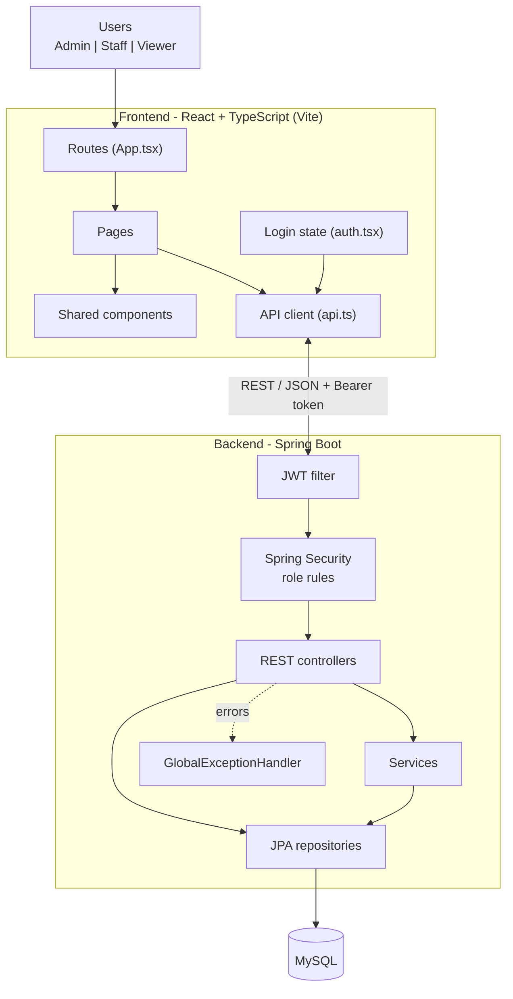

### 2. Project directory structure

Build output (`frontend/node_modules`, `target/`, `src/main/resources/static/`)
and local editor settings are left out.

```text
campus-erp/
├── .github/workflows/ci.yml
├── .mvn/wrapper/maven-wrapper.properties
├── frontend/
│   ├── index.html
│   ├── package.json
│   ├── package-lock.json
│   ├── tsconfig.json
│   ├── vite.config.ts
│   └── src/
│       ├── main.tsx
│       ├── App.tsx
│       ├── auth.tsx
│       ├── api.ts
│       ├── styles.css
│       ├── components/
│       │   ├── CalendarView.tsx
│       │   ├── CrudSection.tsx
│       │   ├── ExpenseTable.tsx
│       │   └── ui.tsx
│       ├── layout/
│       │   └── Layout.tsx
│       ├── lib/
│       │   ├── format.ts
│       │   ├── types.ts
│       │   └── useLoad.ts
│       └── pages/
│           ├── BudgetDetailPage.tsx
│           ├── BudgetsPage.tsx
│           ├── CalendarPage.tsx
│           ├── CoursesPage.tsx
│           ├── DashboardPage.tsx
│           ├── EventsPage.tsx
│           ├── FacultyDetailPage.tsx
│           ├── FacultyPage.tsx
│           ├── LoginPage.tsx
│           ├── PlaceholderPage.tsx
│           ├── ProjectsPage.tsx
│           ├── SetupPage.tsx
│           ├── StudentDetailPage.tsx
│           ├── StudentsPage.tsx
│           ├── TrainingPage.tsx
│           ├── TrainingProgramPage.tsx
│           └── UsersPage.tsx
├── src/
│   ├── main/
│   │   ├── java/com/campuserp/
│   │   │   ├── CampusErpApplication.java
│   │   │   ├── auth/          AuthController, JwtService, JwtAuthFilter
│   │   │   ├── budget/        Budget, Expense, BudgetService, ExpenseService, BudgetController, ...
│   │   │   ├── calendar/      CalendarService, CalendarController, CalendarEntry
│   │   │   ├── common/        BaseEntity, ApiError, GlobalExceptionHandler, Finder, Money, Ref, ...
│   │   │   ├── config/        SecurityConfig, ClockConfig, SpaForwardController,
│   │   │   │                  DevDefaultsGuard, JwtSecretCheck
│   │   │   ├── course/        Course, CourseOffering, OfferingTeacher, TimetableSlot,
│   │   │   │                  ClassException, OfferingService, CourseController, OfferingController, ...
│   │   │   ├── dashboard/     DashboardController
│   │   │   ├── event/         Event, EventController, EventRepository, EventStatus
│   │   │   ├── faculty/       Faculty, FacultyController, FacultyRepository, FacultyStatus
│   │   │   ├── project/       ResearchProject, ProjectMember, ProjectController, ...
│   │   │   ├── seed/          DemoAccountsSeeder, DemoDataSeeder, Csv
│   │   │   ├── setup/         Department, Programme, Section, AcademicYear, Holiday,
│   │   │   │                  AcademicCalendar, SetupController, ...
│   │   │   ├── student/       Student, Enrolment, StudentController, ...
│   │   │   ├── training/      TrainingProgram, TrainingClient, AcceptanceChange, TrainingService, ...
│   │   │   └── user/          User, Role, UserService, UserController, ...
│   │   └── resources/
│   │       ├── application.properties
│   │       ├── application-dev.properties
│   │       ├── META-INF/spring.factories
│   │       └── sample-data/   21 CSV files + README.md
│   └── test/
│       ├── java/com/campuserp/
│       │   ├── ApiTest.java, Fixtures.java, TestClock.java, TestLogins.java
│       │   ├── CampusErpApplicationTests.java
│       │   ├── budget/BudgetAndExpenseTest.java
│       │   ├── calendar/CalendarTest.java
│       │   ├── common/HealthAndErrorsTest.java
│       │   ├── config/DevDefaultsGuardTest.java, SpaForwardTest.java
│       │   ├── course/OfferingsTest.java
│       │   ├── seed/SampleDataTest.java
│       │   ├── student/EnrolmentTest.java
│       │   ├── training/TrainingTest.java
│       │   └── user/AuthAndRolesTest.java
│       └── resources/application.properties
├── .gitattributes
├── .gitignore
├── HELP.md
├── README.md
├── mvnw, mvnw.cmd
└── pom.xml
```

### 3. Frontend startup and routing

`main.tsx` wraps the whole app in the router and the login state. The login
page sits outside the layout; every other page needs a login, and Users also
needs the admin role.

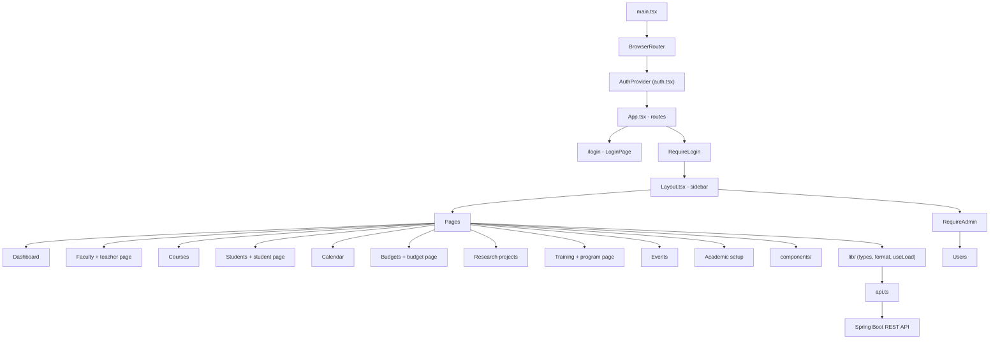

### 4. Frontend files by role

```mermaid
flowchart TB
    A["Frontend"]

    A --> B["Login"]
    A --> C["Layout"]
    A --> D["Pages"]
    A --> E["Shared components"]
    A --> F["Utilities"]
    A --> G["Talking to the API"]

    B --> B1["auth.tsx - who is logged in, role checks"]
    B --> B2["LoginPage.tsx"]

    C --> C1["Layout.tsx - sidebar, user box"]

    D --> D1["DashboardPage"]
    D --> D2["StudentsPage, StudentDetailPage"]
    D --> D3["FacultyPage, FacultyDetailPage"]
    D --> D4["CoursesPage - catalogue and offerings"]
    D --> D5["TrainingPage, TrainingProgramPage"]
    D --> D6["ProjectsPage"]
    D --> D7["BudgetsPage, BudgetDetailPage"]
    D --> D8["EventsPage"]
    D --> D9["CalendarPage"]
    D --> D10["SetupPage"]
    D --> D11["UsersPage"]

    E --> E1["CrudSection - list + add/edit/delete form"]
    E --> E2["CalendarView - FullCalendar day/week/month"]
    E --> E3["ExpenseTable - approve / reject"]
    E --> E4["ui.tsx - badges, usage bar, tabs, messages"]

    F --> F1["types.ts - API shapes"]
    F --> F2["format.ts - rupees, dates, times"]
    F --> F3["useLoad.ts - load an endpoint"]

    G --> G1["api.ts - fetch, token, error messages"]
```

### 5. Backend layers

Bigger modules (courses, budgets, training, users) have a service class.
Simpler ones (setup, faculty, students, events, projects) call their
repositories straight from the controller.

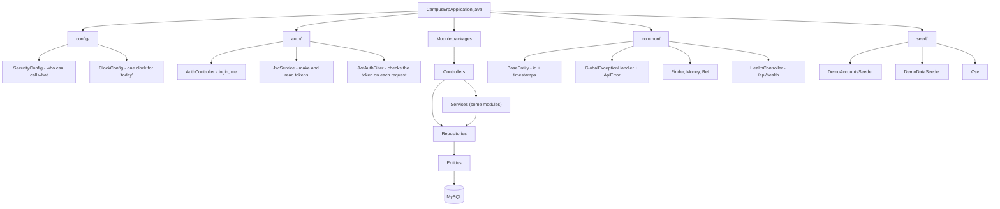

### 6. Backend packages

```mermaid
flowchart TD
    ROOT["com.campuserp"]

    ROOT --> AUTH["auth"]
    ROOT --> CONFIG["config"]
    ROOT --> COMMON["common"]
    ROOT --> USER["user"]
    ROOT --> SETUP["setup"]
    ROOT --> FACULTY["faculty"]
    ROOT --> COURSE["course"]
    ROOT --> STUDENT["student"]
    ROOT --> CALENDAR["calendar"]
    ROOT --> BUDGET["budget"]
    ROOT --> PROJECT["project"]
    ROOT --> TRAINING["training"]
    ROOT --> EVENT["event"]
    ROOT --> DASH["dashboard"]
    ROOT --> SEED["seed"]

    AUTH --> A1["AuthController, JwtService, JwtAuthFilter"]
    CONFIG --> C1["SecurityConfig, ClockConfig,<br/>SpaForwardController, DevDefaultsGuard,<br/>JwtSecretCheck"]
    COMMON --> CM1["BaseEntity, ApiError, GlobalExceptionHandler,<br/>NotFoundException, BusinessRuleException,<br/>Finder, Money, Ref, HealthController"]
    USER --> U1["UserController, UserService,<br/>UserRepository, User, Role"]
    SETUP --> SE1["SetupController, AcademicCalendar,<br/>Department, Programme, Section,<br/>AcademicYear, Holiday + repositories"]
    FACULTY --> F1["FacultyController, FacultyRepository,<br/>Faculty, FacultyStatus"]
    COURSE --> CR1["CourseController, OfferingController,<br/>OfferingService, Course, CourseOffering,<br/>OfferingTeacher, TimetableSlot, ClassException + repositories"]
    STUDENT --> S1["StudentController, Student,<br/>Enrolment + repositories"]
    CALENDAR --> CA1["CalendarController, CalendarService,<br/>CalendarEntry"]
    BUDGET --> BU1["BudgetController, BudgetService,<br/>ExpenseService, Budget, Expense + repositories"]
    PROJECT --> P1["ProjectController, ResearchProject,<br/>ProjectMember + repositories"]
    TRAINING --> T1["TrainingController, TrainingService,<br/>TrainingProgram, TrainingClient,<br/>AcceptanceChange + repositories"]
    EVENT --> EV1["EventController, EventRepository, Event"]
    DASH --> D1["DashboardController"]
    SEED --> SD1["DemoAccountsSeeder, DemoDataSeeder, Csv"]
```

### 7. Login and access checks

The password is checked against the BCrypt hash in the database. After that,
every request carries the token, and the user's role is looked up again each
time, so a role change or disabled account takes effect straight away.

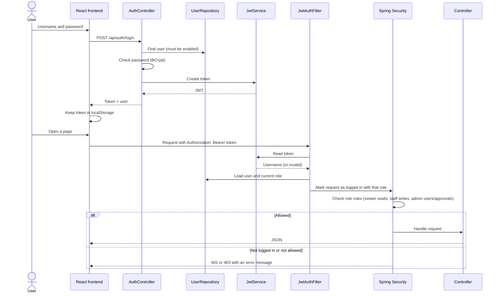

### 8. One request from click to database

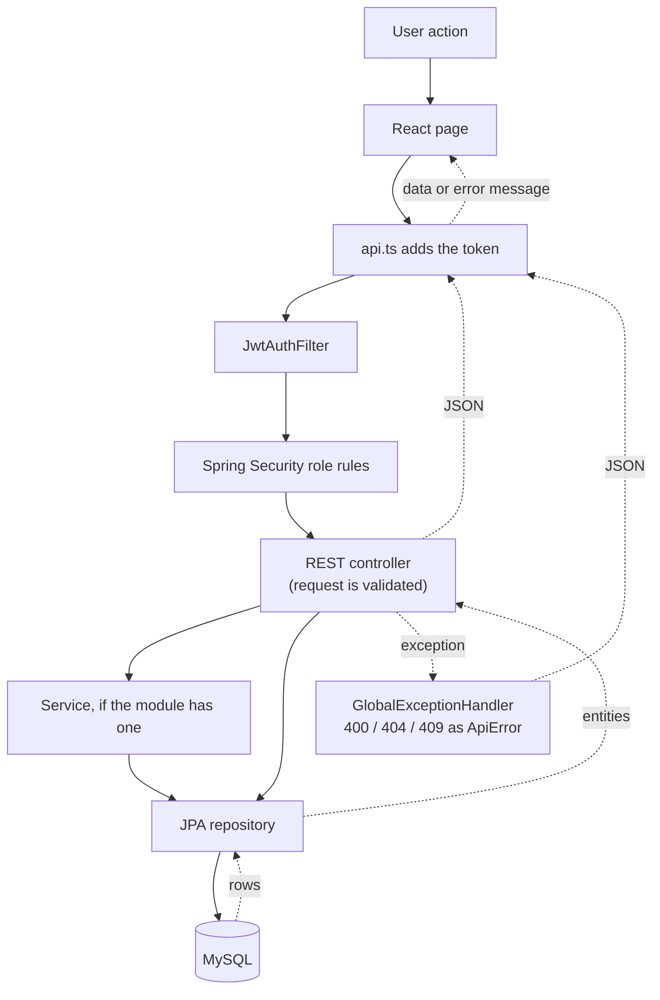

### 9. Academic structure

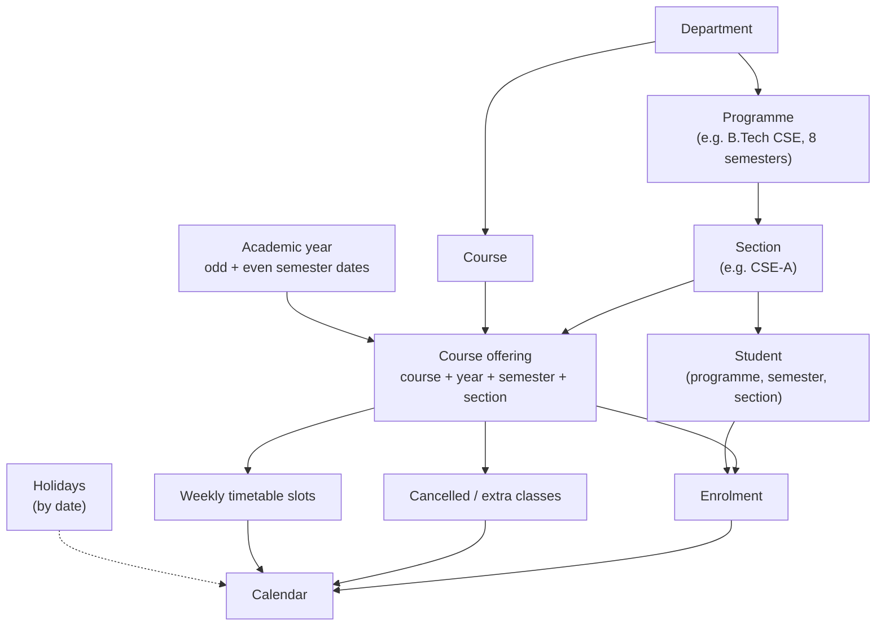

### 10. Students and enrolment

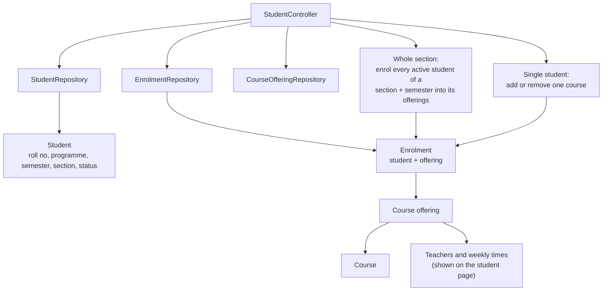

### 11. Courses and timetable

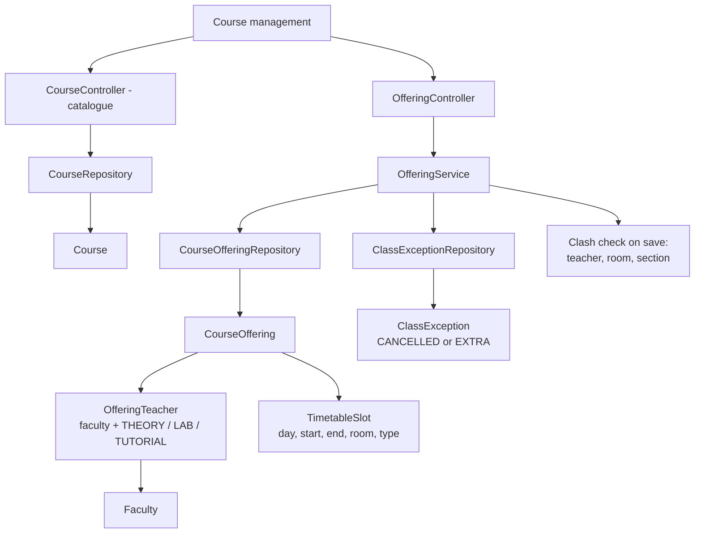

### 12. Faculty

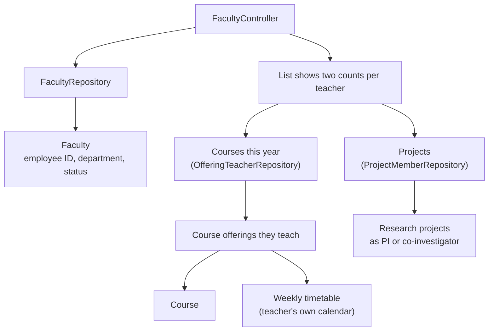

### 13. Training programs

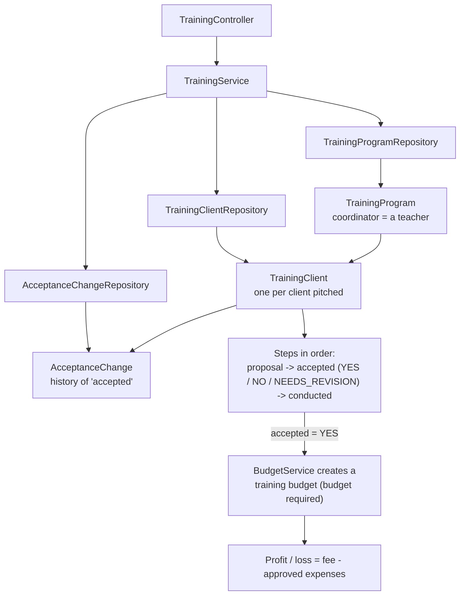

### 14. Research projects

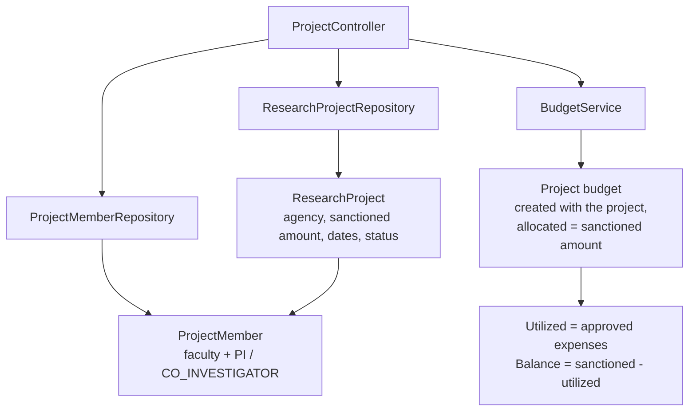

### 15. Budgets and expenses

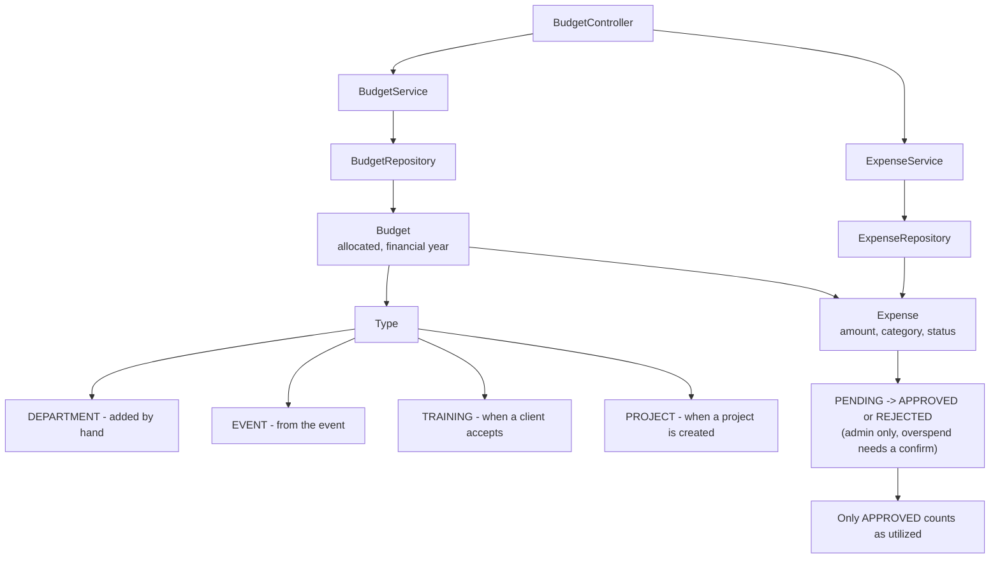

### 16. Events and the calendar

These are separate. Events can have a budget. The calendar only shows
classes, worked out on request; nothing calendar-related is stored.

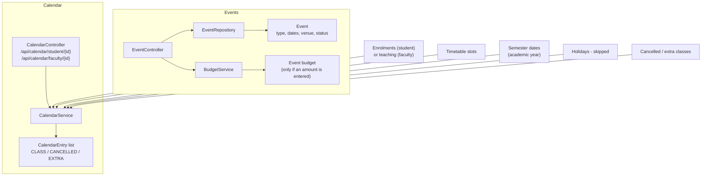

### 17. Dashboard

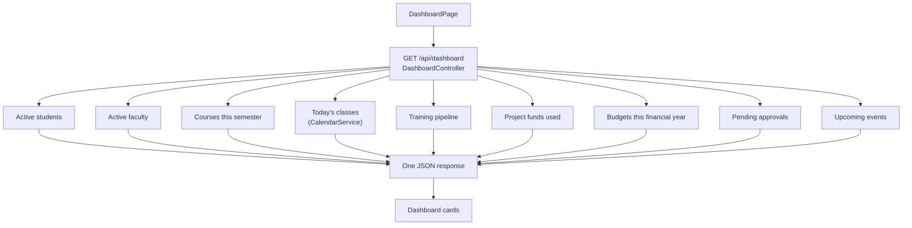

### 18. Academic setup

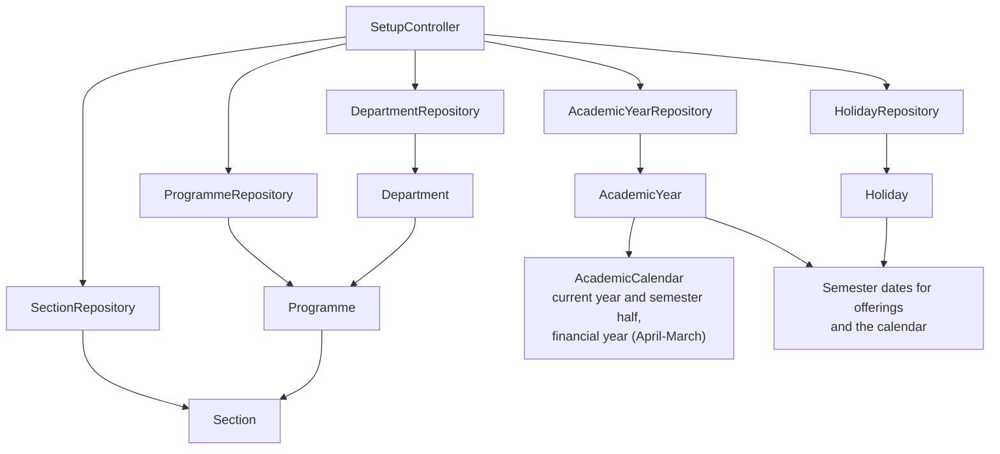

### 19. Database tables and links

Every table also has `id`, `created_at` and `updated_at`. App users are
separate from faculty and students.


### 20. Startup and sample data

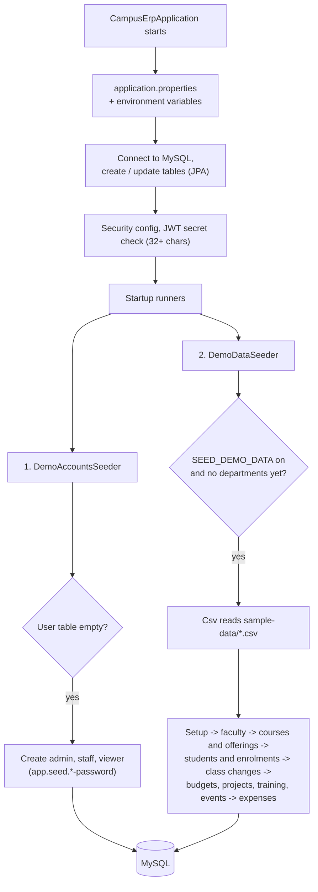
